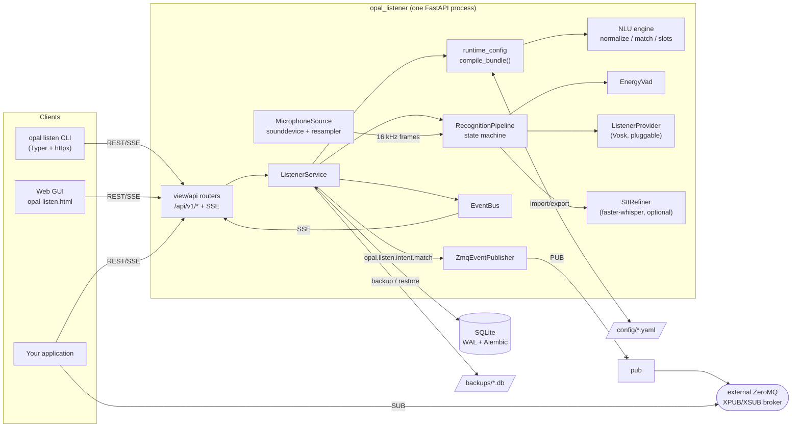
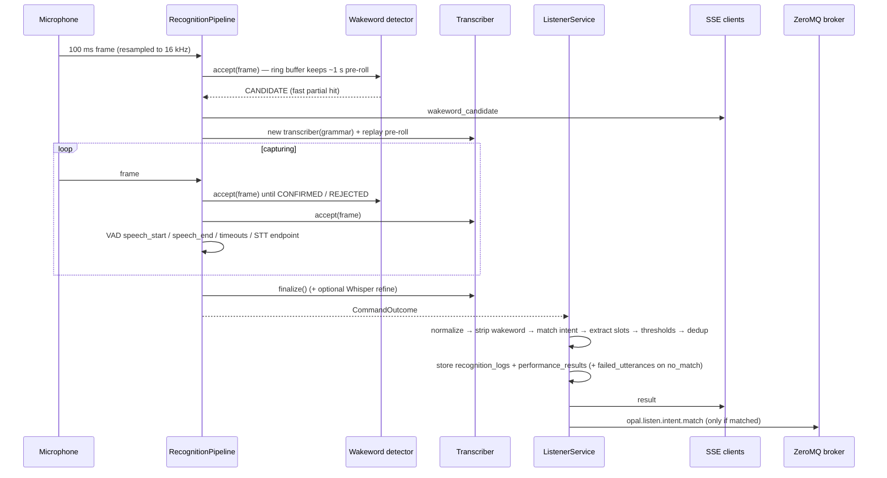
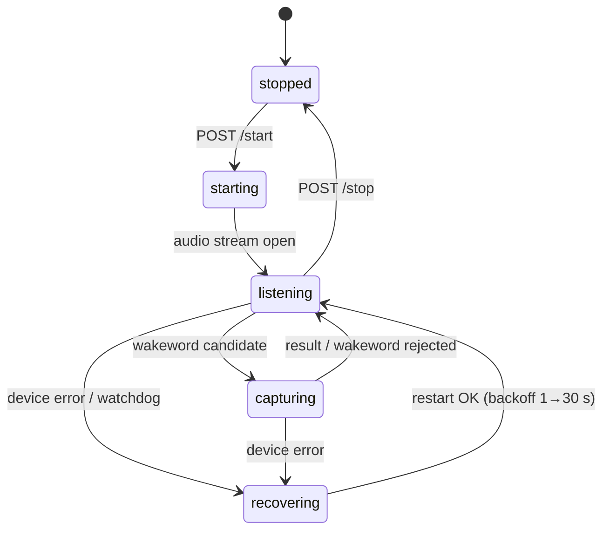
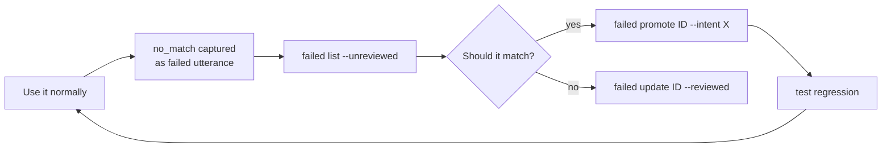

# opal_listener User Guide

`opal_listener` is a local wakeword, speech-to-text (STT), intent recognition and slot extraction engine
for Raspberry Pi 5 and Linux. It hears something like *"computer, turn on the kitchen light"* and returns
structured JSON:

```json
{
  "wakeword": "computer",
  "transcript": "turn on the kitchen light",
  "intent_name": "light_turn_on",
  "slot_values": {"room_name": "kitchen"},
  "intent_confidence": 1.0,
  "matched": true
}
```

It does **not** execute commands. It only recognizes them. Your own code subscribes to the results
(REST or Server-Sent Events) and acts on them.

There are three ways to use it, and all three can do the same things:

| Interface | Use it for | Entry point |
|---|---|---|
| REST API (+ SSE) | Integrations, automation, scripts | `http://<host>:8000/api/v1/...`, docs at `/docs` |
| CLI | Terminal use, shell scripts, CI | `opal listen <group> <command>` |
| Web GUI | Interactive configuration, testing and tuning | `http://<host>:8000/ui/opal-listen.html` |

---

## Table of contents

1. [Concepts](#1-concepts)
2. [Installation](#2-installation)
3. [Architecture](#3-architecture)
4. [Configuration reference](#4-configuration-reference)
5. [REST API reference](#5-rest-api-reference)
6. [Live results: Server-Sent Events](#6-live-results-server-sent-events)
7. [CLI reference](#7-cli-reference)
8. [Web GUI guide](#8-web-gui-guide)
9. [Recipes and workflows](#9-recipes-and-workflows)
10. [Integrating with your application](#10-integrating-with-your-application)
11. [Testing](#11-testing)
12. [Troubleshooting and FAQ](#12-troubleshooting-and-faq)
13. [Appendix: operation ↔ CLI ↔ GUI map](#13-appendix-operation--cli--gui-map)

---

## 1. Concepts

| Term | Meaning | Example |
|---|---|---|
| **Wakeword** | A word or phrase that opens a command session. Names are normalized (lowercase, no punctuation). | `computer`, `hey opal` |
| **Intent** | A named action the user wants. Names are `snake_case` and unique. `no_match` is reserved. | `light_turn_on` |
| **Phrase** | A training template for an intent. It can contain slots, optional words and alternatives. | `turn on [the] {room_name} (light \| lights)` |
| **Slot** | A typed parameter extracted from the utterance. Types: `list`, `number`, `text`. | `room_name`, `temperature` |
| **Slot value** | A canonical value of a `list` slot, returned in `slot_values`. | `living_room` |
| **Alias** | Another way to say a slot value. It normalizes to the canonical value. | `lounge` → `living_room` |
| **Profile** | Environment preset: wakewords, thresholds, VAD tuning, model paths, enabled intents/slots. Exactly one is active. | `default`, `noisy_room`, `car`, `kitchen` |
| **Setting** | A typed global key/value, for example `cooldown_ms` or `stt_mode`. | `cooldown_ms = 1500` |
| **Recognition log** | Every recognition result (mic, audio file or text), stored in SQLite. | |
| **Failed utterance** | A `no_match` result saved for review. It can be *promoted* to a training phrase. | |
| **Regression test** | A phrase that must keep resolving to an expected intent and slots. | |
| **Pipeline** | The live microphone loop: wakeword → VAD → STT → intent. | |

### Phrase syntax

| Syntax | Meaning | Example | Matches |
|---|---|---|---|
| `word` | Literal word | `what time is it` | "what time is it" |
| `{slot}` | Slot placeholder (the slot must exist) | `set timer for {duration_minutes} minutes` | "set timer for five minutes" |
| `[words]` | Optional words | `turn on [the] {room_name} light` | "turn on kitchen light", "turn on the kitchen light" |
| `(a \| b)` | Alternatives | `(light \| lights)` | "light" or "lights" |

Templates are expanded into concrete variants (at most 128 per phrase). Invalid phrases are rejected with
HTTP `422` and nothing is saved. Examples of invalid phrases: an unknown slot, the same slot used twice,
or unbalanced brackets.

### Slot types

| Type | Values | Output | Notes |
|---|---|---|---|
| `list` | Fixed canonical values plus aliases | Canonical value string, e.g. `"living_room"` | Underscores in values are spoken as spaces ("living room"). Fuzzy matching uses `slot_fuzzy_min_score`. |
| `number` | Spoken or digit numbers | Integer, e.g. `21` | "twenty one", "21", "one hundred", "two thousand" |
| `text` | Free text | String | Needs open dictation. In `grammar` mode the engine falls back to open mode and shows a warning. |

---

## 2. Installation

### 2.1 Prerequisites

- Linux or Raspberry Pi OS (64-bit), Python **3.11–3.13**
- PortAudio for microphone capture:
  ```bash
  sudo apt install libportaudio2
  ```
- A Vosk model, for example `vosk-model-small-en-us-0.15` from https://alphacephei.com/vosk/models.
  The small model loads fast and has a low memory footprint. Larger models are more accurate.
- Optional: `espeak` and `sox`, only needed to regenerate the audio test fixtures.

### 2.2 Install from source

```bash
cd /gh/opal/opal-listen
python3 -m venv .venv
source .venv/bin/activate
pip install -e ".[dev]"              # dev tools (pytest, ruff)
# pip install -e ".[dev,whisper]"    # also installs the optional faster-whisper refiner
```

This installs two commands:

| Command | Purpose |
|---|---|
| `opal-listener-server` | Runs the API server (same as `python -m opal_listener`) |
| `opal` | The CLI (`opal listen ...`); also `python -m opal_listener.cli` |

### 2.3 Download a model

```bash
mkdir -p ~/models && cd ~/models
wget https://alphacephei.com/vosk/models/vosk-model-small-en-us-0.15.zip
unzip vosk-model-small-en-us-0.15.zip
export OPAL_LISTENER_VOSK_MODEL_PATH=~/models/vosk-model-small-en-us-0.15
```

A valid model directory contains `am/` and `conf/` subdirectories.

### 2.4 Environment variables

Process-level settings come from environment variables or a `.env` file in the working directory. The
prefix is `OPAL_LISTENER_`.

| Variable | Default | Purpose |
|---|---|---|
| `OPAL_LISTENER_VOSK_MODEL_PATH` | `/nabu/ears/vosk/models/vosk-model-small-en-us-0.15` | Default Vosk model directory |
| `OPAL_LISTENER_DATA_DIR` | `var` | Directory for the SQLite database and `backups/` |
| `OPAL_LISTENER_DATABASE_FILE` | `opal_listener.db` | Database file name inside the data dir |
| `OPAL_LISTENER_BACKUP_DIR_NAME` | `backups` | Backup subdirectory inside the data dir |
| `OPAL_LISTENER_CONFIG_DIR` | `opal_listener/config` | YAML used to seed an empty database and by `import` without a body |
| `OPAL_LISTENER_HOST` | `0.0.0.0` | Bind address. Use `127.0.0.1` for local-only access. |
| `OPAL_LISTENER_PORT` | `8000` | API port |
| `OPAL_LISTENER_CORS_ORIGINS` | `["*"]` | Browser origins allowed to call the API (JSON list) |
| `OPAL_LISTENER_MAX_UPLOAD_BYTES` | `10485760` (10 MiB) | Maximum WAV upload size |
| `OPAL_LISTENER_SEED_ON_EMPTY` | `true` | Seed an empty database from the config dir on startup |
| `OPAL_LISTEN_API_URL` | `http://localhost:8000` | API URL used by the **CLI** (no `ER`) |
| `OPAL_EVENT_API_URL` | `http://127.0.0.1:8080` | opal-event REST API URL for publishing matched intent events |
| `OPAL_EVENT_API_TOKEN` | _None_ | Optional Bearer token for authenticating to opal-event REST API |
| `OPAL_EVENT_TRANSPORT` | `http` | Event transport: `http` (default for opal-event REST), `zmq`, or `both` |
| `OPAL_EVENT_XPUB_URL` | `tcp://127.0.0.1:5559` | ZeroMQ broker endpoint the server publishes `opal.listen.intent.match` to (when transport is `zmq` or `both`), and `opal listen event publish` connects to (no `OPAL_LISTENER_` prefix, shared with the CLI) |
| `OPAL_EVENT_XSUB_URL` | `tcp://127.0.0.1:5560` | ZeroMQ broker's other endpoint (CLI-only today, reserved for future use) |

Example `.env` file:

```dotenv
OPAL_LISTENER_VOSK_MODEL_PATH=/home/pi/models/vosk-model-small-en-us-0.15
OPAL_LISTENER_DATA_DIR=/home/pi/opal-data
OPAL_LISTENER_HOST=0.0.0.0
OPAL_LISTENER_PORT=8000
OPAL_LISTENER_CORS_ORIGINS=["http://192.168.1.20:3000"]
```

### 2.5 First start

```bash
opal-listener-server                 # or: python -m opal_listener
```

On first start the server:

1. Creates the data dir (`var/`) and `var/backups/`.
2. Runs the Alembic migrations on `var/opal_listener.db` (SQLite, WAL mode).
3. Seeds the empty database from `opal_listener/config/*.yaml`: the wakeword `computer`, the
   light/temperature/timer/time/cancel intents, the `room_name`/`temperature`/`duration_minutes` slots and
   the `default`, `noisy_room`, `car` and `kitchen` profiles.
4. Compiles the configuration into a runtime snapshot.
5. Starts the microphone pipeline, but only if the `auto_start_listener` setting is `true`.

Useful URLs:

| URL | What |
|---|---|
| `http://localhost:8000/` | Service info |
| `http://localhost:8000/docs` | Swagger UI (interactive API docs) |
| `http://localhost:8000/redoc` | ReDoc |
| `http://localhost:8000/openapi.json` | OpenAPI schema |
| `http://localhost:8000/ui/opal-listen.html` | Web GUI |

### 2.6 Verify the installation

```bash
opal listen system ping
opal listen system doctor
opal listen test text "computer, turn on the kitchen light"
opal listen test audio opal_listener/tests/audio/fixtures/golden_kitchen_light_on.wav
opal listen test listen-debug        # live microphone, Ctrl-C to stop
```

`system doctor` should show `✓` on every line. Microphone problems show as warnings, because text and
audio-file tests still work without a microphone. A missing model shows as an error.

### 2.7 Access from other machines

The server listens on all interfaces by default. Find the Pi's address, then connect from another machine:

```bash
hostname -I                                      # on the Pi
export OPAL_LISTEN_API_URL=http://192.168.1.50:8000   # on your laptop
opal listen system doctor
# browser: http://192.168.1.50:8000/ui/opal-listen.html
```

If a firewall is active, open the port for your subnet only:

```bash
sudo ufw allow from 192.168.1.0/24 to any port 8000 proto tcp
```

> **Security:** the API has no authentication. Keep it on a trusted network, or set
> `OPAL_LISTENER_HOST=127.0.0.1` to restrict it to the local machine. Narrow
> `OPAL_LISTENER_CORS_ORIGINS` if browsers on other origins should not call it.

### 2.8 Run as a systemd service (example)

`/etc/systemd/system/opal-listener.service`:

```ini
[Unit]
Description=opal_listener wakeword/STT/intent API
After=network-online.target sound.target
Wants=network-online.target

[Service]
User=pi
Group=audio
WorkingDirectory=/home/pi/opal-listen
Environment=OPAL_LISTENER_VOSK_MODEL_PATH=/home/pi/models/vosk-model-small-en-us-0.15
Environment=OPAL_LISTENER_DATA_DIR=/home/pi/opal-data
ExecStart=/home/pi/opal-listen/.venv/bin/opal-listener-server
Restart=on-failure
RestartSec=3

[Install]
WantedBy=multi-user.target
```

```bash
sudo systemctl daemon-reload
sudo systemctl enable --now opal-listener
journalctl -u opal-listener -f
opal listen settings set auto_start_listener true   # start the microphone on every boot
```

### 2.9 Docker

```bash
cd opal_listener
VOSK_MODELS_DIR=/path/to/models docker compose up -d --build
opal listen system doctor
```

| Compose variable | Default | Purpose |
|---|---|---|
| `VOSK_MODELS_DIR` | `/nabu/ears/vosk/models` | Host directory with models, mounted read-only at `/models` |
| `VOSK_MODEL_NAME` | `vosk-model-small-en-us-0.15` | Model subdirectory to use |
| `OPAL_LISTENER_PORT` | `8000` | Host port |
| `AUDIO_GID` | `29` | Host `audio` group id (check with `getent group audio`) |
| `OPAL_LISTENER_EXTRAS` | empty | Set to `whisper` to build with faster-whisper |

The container:

- runs as the non-root user `opal` in the `audio` group
- gets `/dev/snd` for the microphone
- stores SQLite and backups in the `listener_data` volume (`/data`)
- reads `opal_listener/config` as its seed (`/config`, read-only)
- has a health check on `/healthz`

```bash
docker compose logs -f listener
docker compose exec listener opal listen system doctor
```

### 2.10 Upgrading

```bash
git pull
pip install -e ".[dev]"
opal listen config backup            # optional safety copy
sudo systemctl restart opal-listener # migrations run automatically on startup
opal listen system doctor            # the "migrations" check shows the current revision
```

---

## 3. Architecture

### 3.1 Big picture



The code is organized in three layers:

| Layer | Package | Responsibility |
|---|---|---|
| View | `opal_listener/view/api/*`, `view/static/opal-listen.html` | Thin FastAPI routers (one per resource) and the single-file GUI |
| Service | `opal_listener/service/*` | Business logic: runtime, pipeline, NLU, providers, audio, backups, health |
| Data | `opal_listener/data/*`, `opal_listener/models/*` | SQLite access, Alembic migrations, SQLModel tables, Pydantic schemas |

The CLI (`opal_listener/cli/*`) is a pure HTTP client, except `event publish` which bypasses REST entirely
and writes straight to the ZeroMQ bus (see [6. Live results](#6-live-results-server-sent-events)).

### 3.2 Components

| Component | What it does |
|---|---|
| `ListenerService` | Owns the runtime snapshot, provider instances, the live runtime thread, watchdog/recovery, cooldown/dedup, logging, performance tracking, validated config changes, import/backup/restore and event publishing. |
| `ListenerProvider` (`providers/base.py`) | Pluggable speech engine. It creates wakeword detectors and grammar-constrained transcribers. `vosk` is built in. Third-party providers register through the `opal_listener.providers` entry point. |
| `VoskListenerProvider` | Model cache, two-stage wakeword detector, grammar transcriber and out-of-vocabulary filtering. |
| `SttRefiner` (`whisper_refiner.py`) | Optional second-pass STT with faster-whisper. |
| `RecognitionPipeline` | Frame-driven state machine: idle (wakeword + pre-roll ring buffer) → capturing (transcriber + VAD + wake confirmation) → outcome. Live audio and uploaded WAVs use the same pipeline. |
| `MicrophoneSource` | Device resolution, sample-rate probing and a streaming decimator (for example 48 kHz → 16 kHz). |
| `EnergyVad` | Energy-based voice activity detection with an adaptive noise floor. |
| NLU (`service/nlu/*`) | Normalization, filler removal, wakeword stripping, template expansion, number parsing, intent matching, slot extraction and grammar generation. |
| `runtime_config` | Validates a whole configuration bundle and compiles the immutable `RuntimeSnapshot` for the active profile. |
| `EventBus` | Fan-out of pipeline events to SSE subscribers. Queues are bounded and drop the oldest events. |
| `ZmqEventPublisher` (`service/zmq_events.py`) | Publishes matched recognitions to an external ZeroMQ broker (topic `opal.listen.intent.match`, `--xpub`/`OPAL_EVENT_XPUB_URL`). Connected eagerly at startup; best-effort, never raises. |

### 3.3 Live recognition flow



Key design decisions:

- **Two-stage wakeword.** A fast `[wakeword, [unk]]` recognizer opens the session on a *partial* hit, so
  no command audio is lost. A second recognizer that also knows sound-alike *distractors* (`commuter`,
  `compute`, ...) then confirms the wakeword with a real confidence or rejects it.
- **Grammar-constrained STT.** The command transcriber only knows the words in your enabled phrases,
  slot values, aliases and number words. This greatly reduces misrecognitions on small models.
  `stt_mode=open` switches to open dictation.
- **One code path.** Uploaded WAV files go through the same pipeline as the live microphone, so audio tests
  exercise production code.
- **One validation path.** Every configuration change (CRUD, YAML import, restore) is compiled by the same
  `compile_bundle()` function before it is applied.
- **Two independent event channels.** SSE (`EventBus`) requires an open HTTP connection and carries every
  pipeline event; the ZeroMQ bus (`ZmqEventPublisher`) requires an external broker and carries only
  matched-intent events, for integrations that prefer pub/sub over HTTP.

### 3.4 Pipeline states

`GET /api/v1/recognition/status` reports one of these states:



A capture session ends for one of these reasons (the `speech_end` event includes the reason):

| End reason | Meaning |
|---|---|
| `speech_end` | Silence for `silence_end_ms` after speech started |
| `stt_endpoint` | The STT engine detected an endpoint and command words were heard (`use_stt_endpoint`) |
| `no_speech` | No speech within `no_speech_timeout_ms` after the wakeword |
| `max_length` | Hard cap `max_utterance_ms` reached |

### 3.5 Intent matching

For every enabled phrase variant, the engine:

1. **Normalizes** the transcript: lowercase, strips punctuation, turns `-` and `_` into spaces, and drops
   `[unk]` and filler words (`filler_words`).
2. **Strips the wakeword.** Everything before and including the first wakeword is removed. Longer
   wakewords win over shorter ones that share a prefix.
3. **Delexicalizes** slot surfaces (exact, then fuzzy values/aliases, then numbers).
4. **Aligns** the transcript with the variant using a weighted LCS (stopwords 0.4, words 1.0, slots 1.5,
   fuzzy token equality ≥ `token_fuzzy_min_score`) and scores it with a weighted Jaccard.
5. Computes `intent_confidence = alignment × mean slot score`.
6. Applies thresholds: effective threshold = `max(intent.confidence_threshold, profile.confidence_thresholds.intent)`.

The best candidate wins. Up to a few runners-up are returned in `alternatives`.

`no_match_reason` values:

| Reason | Meaning | What to try |
|---|---|---|
| `empty_transcript` | Nothing left after normalization and wakeword stripping | Speak after the wakeword; check levels |
| `no_candidate` | No phrase is similar enough | Add a phrase or promote the failure |
| `missing_slot` | A phrase matched but a required slot could not be extracted | Add values/aliases |
| `below_threshold` | Best score is below the effective threshold | Add phrases, or lower the threshold |
| `low_stt_confidence` | STT confidence is below the profile's `stt` floor | Improve the mic/room, or lower the floor |
| `no_speech` | Session ended with no speech (VAD timeout) | Tune VAD or mic gain |
| `no_wakeword` | `require_wakeword=true` and no wakeword was heard | Include the wakeword |

### 3.6 Validate before apply

Every configuration mutation runs inside `ListenerService.config_change()`:

```
flush change → export DB to bundle → compile_bundle() → provider checks (model path) → commit → atomic snapshot swap
```

If any step fails, the transaction is rolled back and the running snapshot is untouched. The client
gets `422` with the list of errors. You cannot leave the engine in a broken state through the API.

Live pipelines pick up a new snapshot the next time they are idle, without a restart.

### 3.7 Storage

SQLite database (default `var/opal_listener.db`), managed by Alembic, with foreign keys on and WAL mode:

| Table | Holds |
|---|---|
| `wakewords` | name (unique, normalized), enabled, confidence_threshold |
| `intents`, `intent_phrases` | intents and their phrase templates |
| `slots`, `slot_values`, `slot_aliases` | slot definitions, canonical values, aliases |
| `profiles` | environment presets (JSON columns for lists/maps) |
| `settings` | typed key/value settings (stored as strings) |
| `recognition_logs` | every recognition result; pruned to `max_recognition_logs` every 100 results |
| `failed_utterances` | `no_match` results for review |
| `regression_tests` | expected intent/slots per phrase |
| `performance_results` | latency and confidence per recognition |

Backups are SQLite online backups in `var/backups/`, named `opal_listener_<UTC timestamp>_<label>.db`.

### 3.8 Reliability features

| Feature | Behavior |
|---|---|
| Watchdog | Capture is restarted if no audio arrives within `audio_watchdog_timeout_ms` or the device fails. Backoff grows from 1 to 30 s. `audio_restarts` and `last_error` are shown in status. |
| Cooldown | After a mic session, wakewords are ignored for `cooldown_ms`. |
| Dedup | Identical mic results (same intent and slots) within `dedup_window_ms` are flagged `deduplicated: true`. They are still logged. |
| Graceful no_match | Every path returns a `RecognitionResult` with a `no_match_reason`. It never errors. |
| Failure capture | With `auto_capture_failures=true`, `no_match` results from mic and audio sources are stored as failed utterances. Text tests are not captured. |
| Bounded resources | Bounded audio and SSE queues, upload size limit, log retention. |
| Safe backups | Filenames are validated against a strict pattern and resolved inside the backup dir (no path traversal). Restores are integrity-checked and roll back automatically on failure. |
| Health checks | SQLite, migrations, slots, intents, config warnings, provider, vocabulary, microphone, listener, disk. |

---

## 4. Configuration reference

Configuration lives in SQLite and is edited through the API, CLI or GUI. For version control and moving
configuration between machines, it can be exported to and imported from six YAML files (see
[Recipes](#95-back-up-move-and-version-your-configuration)).

### 4.1 YAML files

| File | Top-level key | Content |
|---|---|---|
| `wakewords.yaml` | `wakewords` | list of wakewords |
| `intents.yaml` | `intents` | list of intents with `phrases` |
| `slots.yaml` | `slots` | list of slots with `values` and `aliases` |
| `profiles.yaml` | `profiles` | list of profiles |
| `stt.yaml` | `stt` | speech/audio settings |
| `settings.yaml` | `settings` | runtime settings |

Every file has `version: 1`. Unknown keys are rejected, and settings must go in the right file.

```yaml
# wakewords.yaml
version: 1
wakewords:
  - name: computer
    enabled: true
    confidence_threshold: 0.8
```

```yaml
# intents.yaml
version: 1
intents:
  - name: light_turn_on
    description: Turn on the lights in a room
    enabled: true
    confidence_threshold: 0.75
    phrases:
      - turn on [the] {room_name} (light | lights)
      - switch on [the] {room_name} (light | lights)
      - turn [the] {room_name} (light | lights) on
      - (lights | light) on in [the] {room_name}
  - name: set_temperature
    confidence_threshold: 0.75
    phrases:
      - set [the] temperature to {temperature} [degrees]
      - make it {temperature} degrees
```

```yaml
# slots.yaml
version: 1
slots:
  - name: room_name
    slot_type: list
    description: Rooms with controllable lights
    values:
      - value: kitchen
        aliases: [cooking area]
      - value: living_room
        aliases: [lounge, family room]
  - name: temperature
    slot_type: number
    values: []
```

```yaml
# profiles.yaml
version: 1
profiles:
  - name: default
    is_active: true
  - name: noisy_room
    description: TV or music in the background
    confidence_thresholds: {wakeword: 0.9, intent: 0.8}
    vad_settings: {energy_threshold_dbfs: -38.0, noise_margin_db: 14.0, silence_end_ms: 600}
```

```yaml
# stt.yaml
version: 1
stt:
  listener_provider: vosk
  stt_mode: grammar
  stt_refiner: none
  wakeword_trigger: partial
  audio_device: ""
  audio_capture_rate: 0
  audio_block_ms: 100
```

```yaml
# settings.yaml
version: 1
settings:
  auto_start_listener: false
  cooldown_ms: 1500
  dedup_window_ms: 2000
  auto_capture_failures: true
  filler_words: uh,um,er,please
```

### 4.2 Settings

All settings are stored as strings and validated by type, range and allowed choices when you set them.
Invalid values are rejected with `422`.

**STT and audio settings (`stt.yaml`):**

| Key | Type | Default | Allowed | Description |
|---|---|---|---|---|
| `listener_provider` | str | `vosk` | installed providers | Speech engine implementation |
| `vosk_model_path` | str | `$OPAL_LISTENER_VOSK_MODEL_PATH` | path | Default Vosk model directory. A profile's `model_paths.vosk_model` overrides it. |
| `stt_mode` | str | `grammar` | `grammar`, `open` | `grammar` limits STT to your phrase vocabulary. `open` is full dictation. |
| `stt_refiner` | str | `none` | `none`, `faster_whisper` | Optional second-pass STT |
| `whisper_model` | str | `tiny.en` | name or path | faster-whisper model |
| `whisper_compute_type` | str | `int8` | `int8`, `int8_float32`, `float32` | faster-whisper compute type |
| `wakeword_trigger` | str | `partial` | `partial`, `final` | `partial` opens a session on a partial hit (fast). `final` waits for a final result. |
| `wakeword_distractors` | str | `commuter,compute,computing,commute` | CSV | Sound-alike words that reject false wakeword hits |
| `audio_device` | str | `""` | index or name substring | Input device (`""` = system default) |
| `audio_capture_rate` | int | `0` | 0–192000 | Capture rate (`0` = auto-detect) |
| `audio_block_ms` | int | `100` | 20–500 | Audio frame size in ms |

**Runtime settings (`settings.yaml`):**

| Key | Type | Default | Range | Description |
|---|---|---|---|---|
| `auto_start_listener` | bool | `false` | | Start the microphone pipeline at server startup |
| `cooldown_ms` | int | `1500` | 0–60000 | Ignore wakewords for this long after a session |
| `dedup_window_ms` | int | `2000` | 0–60000 | Flag identical results within this window |
| `auto_capture_failures` | bool | `true` | | Store `no_match` utterances (mic/audio) as failed utterances |
| `filler_words` | str | `uh,um,er,please` | CSV | Words dropped during normalization |
| `slot_fuzzy_min_score` | float | `0.85` | 0–1 | Minimum fuzzy score for slot values |
| `token_fuzzy_min_score` | float | `0.8` | 0–1 | Minimum fuzzy score for phrase tokens |
| `audio_watchdog_timeout_ms` | int | `3000` | 500–60000 | Restart capture if no audio arrives for this long |
| `max_recognition_logs` | int | `10000` | 100–1000000 | Recognition log retention (rows) |

Booleans accept `true/false`, `1/0`, `yes/no` and `on/off`.

### 4.3 Profiles

| Field | Type | Meaning |
|---|---|---|
| `name` | str | Unique name |
| `description` | str | Free text |
| `is_active` | bool | Exactly one profile may be active. Activating one deactivates the others. |
| `wakeword_names` | list | Wakewords used by this profile (empty = all enabled wakewords) |
| `enabled_intents` | list | Intents active in this profile (empty = all) |
| `enabled_slots` | list | Slots active in this profile (empty = all). Phrases using a disabled slot are disabled. |
| `confidence_thresholds` | map | Floors: `wakeword`, `intent`, `stt`. Effective threshold = `max(item threshold, profile floor)`. |
| `vad_settings` | map | VAD overrides (see below) |
| `model_paths` | map | `vosk_model`, `whisper_model` overrides |

**VAD settings (`vad_settings`):**

| Key | Default | Range | Effect |
|---|---|---|---|
| `energy_threshold_dbfs` | `-45.0` | -90–0 | Minimum level that counts as speech |
| `noise_margin_db` | `10.0` | 0–40 | Speech must also be this far above the adaptive noise floor |
| `speech_start_ms` | `150` | 0–2000 | Continuous speech needed to count as speech start |
| `silence_end_ms` | `700` | 100–5000 | Silence that ends the utterance. Raise it if commands get cut off. |
| `no_speech_timeout_ms` | `4000` | 500–30000 | Give up if no speech follows the wakeword |
| `max_utterance_ms` | `8000` | 1000–60000 | Hard cap on a capture session |
| `pre_roll_ms` | `1000` | 0–3000 | Audio kept before the wakeword trigger and replayed to STT |
| `use_stt_endpoint` | `true` | bool | Also end when the STT engine detects an endpoint |

The effective speech threshold is `max(energy_threshold_dbfs, noise_floor + noise_margin_db)`.

If no profile is active, no profile filters or overrides apply.

### 4.4 Validation rules

Configuration is checked for:

- Invalid names (intents and slots must be `snake_case`; `no_match` is reserved)
- Duplicate names or values
- Wakewords that are empty after normalization
- Phrases with unknown or duplicate slots, or bad template syntax
- Slot values or aliases that are empty after normalization, or aliases that map to two values
- More than one active profile
- Settings with unknown keys, wrong types, out-of-range values, or in the wrong file

Some issues are **warnings** only, for example `list` slots without values, ambiguous phrases, intents
without phrases, no enabled wakewords, profiles that reference unknown names, and `text` slots in
`grammar` mode.

---

## 5. REST API reference

### 5.1 Conventions

- **Base URL:** `http://<host>:8000`. All resources are under `/api/v1`.
- **Trailing slashes:** collection endpoints end with `/` (for example `/api/v1/intents/`). Calling them
  without the slash triggers a redirect.
- **IDs:** resources are addressed by integer id in the API. (The CLI also accepts names.)
- **Content type:** JSON (`Content-Type: application/json`), except `test_audio` (multipart form) and
  `backup/download` (binary).
- **Timestamps:** ISO 8601, UTC, for example `2026-09-30T12:34:56.123456`.
- **Authentication:** none (see [Security](#27-access-from-other-machines)).
- **Correlation headers (OPAL SUITE STANDARD v1.2):** every response carries `X-Opal-Transaction-Id` and
  `X-Opal-Request-Id` (assigned by the server if you don't supply them); `X-Opal-Session-Id` and
  `X-Opal-Causation-Id` are echoed back if you send them. All four are opaque 1–128 character printable
  ASCII tokens — an invalid supplied value is rejected with `422`. These are not authentication
  credentials; they only propagate context (e.g. into server logs).
- **Optimistic concurrency:** mutable catalog resources (wakewords, intents, phrases, slots, slot values,
  aliases, profiles, settings) return a strong `ETag`; `PATCH`/`DELETE` require a matching `If-Match`
  (missing/empty → `428`, stale → `412`). See [5.8 Settings](#58-settings--apiv1settings) for a worked
  example.

The examples below use:

```bash
API=http://localhost:8000
```

### 5.2 Errors

| Status | When | Body |
|---|---|---|
| `404` | Resource not found | `{"detail": "intent 99 not found"}` |
| `409` | Duplicate name, value, alias or phrase | `{"detail": "intent 'light_turn_on' already exists"}` |
| `412` | Stale `If-Match` on a mutation | `{"error": {"code": "precondition_failed", "message": "...", "request_id": "...", "transaction_id": "..."}}` |
| `422` | Request validation, or the configuration would become invalid | FastAPI validation shape (below), or `OpalError` for a malformed correlation header / invalid cursor |
| `428` | Missing/empty `If-Match` on a mutation that requires one | `{"error": {"code": "precondition_required", "message": "...", "request_id": "...", "transaction_id": "..."}}` |
| `503` | Listener provider or model unavailable | `{"detail": "listener provider unavailable: ..."}` |

`422` example (config validation errors have `type: config_invalid`):

```json
{
  "detail": [
    {"loc": ["body"], "msg": "intent 'light_color' phrase 'make it {colour}': unknown slot 'colour'", "type": "config_invalid"}
  ]
}
```

Request schema errors use FastAPI's standard shape with `loc` pointing at the field, for example
`["body", "confidence_threshold"]`. Routes with no body/path validation surface of their own (pure
collection `GET`s, health, root) instead document `422` as the OPAL standard error envelope, since the
only way they can fail is an invalid correlation header:

```json
{"error": {"code": "invalid_header", "message": "invalid value for header(s): X-Opal-Session-Id",
           "request_id": "...", "transaction_id": "..."}}
```

---

### 5.3 Service

#### `GET /` — service info

Returns name, version and useful links.

```bash
curl -s $API/
```
```json
{"name": "opal_listener", "version": "0.1.0", "docs": "/docs", "ui": "/ui/opal-listen.html"}
```

#### `GET /healthz` — liveness probe

Cheap check that the process is up. Used by Docker. For real checks use `/api/v1/health/`.

```bash
curl -s $API/healthz
```
```json
{"status": "ok"}
```

---

### 5.4 Wakewords — `/api/v1/wakewords`

Wakeword object:

| Field | Type | Notes |
|---|---|---|
| `id` | int | read-only |
| `name` | str (≤100) | Normalized to lowercase words, unique |
| `enabled` | bool | default `true` |
| `confidence_threshold` | float 0–1 | default `0.8`. A detection below it is rejected. |
| `created_at`, `updated_at` | datetime | read-only |

#### `GET /api/v1/wakewords/` — list wakewords

```bash
curl -s $API/api/v1/wakewords/
```
```json
[
  {"name": "computer", "enabled": true, "confidence_threshold": 0.8, "id": 1,
   "created_at": "2026-09-30T08:00:00", "updated_at": "2026-09-30T08:00:00"}
]
```

#### `POST /api/v1/wakewords/` — create a wakeword

Returns `201`. Returns `409` if the name exists, and `422` if the name is empty after normalization.

```bash
curl -s -X POST $API/api/v1/wakewords/ \
  -H 'Content-Type: application/json' \
  -d '{"name": "Hey Opal", "confidence_threshold": 0.85}'
```
```json
{"name": "hey opal", "enabled": true, "confidence_threshold": 0.85, "id": 2, "created_at": "...", "updated_at": "..."}
```

> Choose wakewords that are in the model vocabulary. `system doctor` warns about unknown words.
> Two or three syllables work best.

#### `GET /api/v1/wakewords/{wakeword_id}` — get one wakeword

```bash
curl -s $API/api/v1/wakewords/2
```

#### `PATCH /api/v1/wakewords/{wakeword_id}` — update a wakeword

Send only the fields you want to change. Requires a strong `If-Match` (fetch it from a `GET` first;
missing → `428`, stale → `412`; see [5.8 Settings](#58-settings--apiv1settings) for the full pattern).

```bash
ETAG=$(curl -si $API/api/v1/wakewords/2 | grep -i '^etag:' | cut -d' ' -f2 | tr -d '\r')
curl -s -X PATCH $API/api/v1/wakewords/2 \
  -H 'Content-Type: application/json' -H "If-Match: $ETAG" \
  -d '{"enabled": false}'
```

#### `DELETE /api/v1/wakewords/{wakeword_id}` — delete a wakeword

Returns `204` with no body. Also requires `If-Match`.

```bash
ETAG=$(curl -si $API/api/v1/wakewords/2 | grep -i '^etag:' | cut -d' ' -f2 | tr -d '\r')
curl -s -X DELETE $API/api/v1/wakewords/2 -H "If-Match: $ETAG" -w '%{http_code}\n'
```

---

### 5.5 Intents — `/api/v1/intents`

Intent object:

| Field | Type | Notes |
|---|---|---|
| `id` | int | read-only |
| `name` | str (≤100) | `snake_case`, unique, not `no_match` |
| `description` | str (≤500) or null | |
| `enabled` | bool | default `true` |
| `confidence_threshold` | float 0–1 | default `0.7` |
| `phrases` | list of phrase objects | in list/get/create responses |

Phrase object: `{id, intent_id, phrase, created_at}`.

#### `GET /api/v1/intents/` — list intents with phrases

```bash
curl -s $API/api/v1/intents/ | jq '.[] | {name, n: (.phrases | length)}'
```
```json
{"name": "light_turn_on", "n": 4}
{"name": "light_turn_off", "n": 4}
{"name": "set_temperature", "n": 2}
```

#### `POST /api/v1/intents/` — create an intent (optionally with phrases)

The intent and its phrases are validated together and created atomically. Returns `201`.

```bash
curl -s -X POST $API/api/v1/intents/ -H 'Content-Type: application/json' -d '{
  "name": "play_music",
  "description": "Start music playback",
  "confidence_threshold": 0.75,
  "phrases": ["play [some] music", "(start | put on) [some] music"]
}'
```
```json
{
  "name": "play_music", "description": "Start music playback", "enabled": true,
  "confidence_threshold": 0.75, "id": 7, "created_at": "...", "updated_at": "...",
  "phrases": [
    {"phrase": "play [some] music", "id": 31, "intent_id": 7, "created_at": "..."},
    {"phrase": "(start | put on) [some] music", "id": 32, "intent_id": 7, "created_at": "..."}
  ]
}
```

Example of a rejected phrase (unknown slot). The response is `422` and nothing is saved:

```bash
curl -s -X POST $API/api/v1/intents/ -H 'Content-Type: application/json' \
  -d '{"name": "bad_one", "phrases": ["play {genre}"]}'
```

#### `GET /api/v1/intents/{intent_id}` — get an intent with phrases

```bash
curl -s $API/api/v1/intents/1
```

#### `PATCH /api/v1/intents/{intent_id}` — update an intent

Updates `name`, `description`, `enabled` or `confidence_threshold`. The response does not include
phrases. Requires `If-Match` (fetch from a `GET` on this intent first).

```bash
ETAG=$(curl -si $API/api/v1/intents/7 | grep -i '^etag:' | cut -d' ' -f2 | tr -d '\r')
curl -s -X PATCH $API/api/v1/intents/7 -H 'Content-Type: application/json' -H "If-Match: $ETAG" \
  -d '{"confidence_threshold": 0.8, "enabled": true}'
```

#### `DELETE /api/v1/intents/{intent_id}` — delete an intent and its phrases

Requires `If-Match`.

```bash
ETAG=$(curl -si $API/api/v1/intents/7 | grep -i '^etag:' | cut -d' ' -f2 | tr -d '\r')
curl -s -X DELETE $API/api/v1/intents/7 -H "If-Match: $ETAG"
```

#### `GET /api/v1/intents/{intent_id}/phrases` — list phrases

```bash
curl -s $API/api/v1/intents/1/phrases
```
```json
[
  {"phrase": "turn on [the] {room_name} (light | lights)", "id": 1, "intent_id": 1, "created_at": "..."},
  {"phrase": "switch on [the] {room_name} (light | lights)", "id": 2, "intent_id": 1, "created_at": "..."}
]
```

#### `POST /api/v1/intents/{intent_id}/phrases` — add a phrase

Returns `201`. Returns `409` for a duplicate phrase and `422` for an invalid template.

```bash
curl -s -X POST $API/api/v1/intents/1/phrases -H 'Content-Type: application/json' \
  -d '{"phrase": "illuminate [the] {room_name}"}'
```

#### `DELETE /api/v1/intents/{intent_id}/phrases/{phrase_id}` — delete a phrase

Phrases have no `GET` of their own; fetch the `If-Match` from the parent phrases list (the ETag covers
the whole list, so it's scoped to "this intent's phrases haven't changed since you listed them").

```bash
ETAG=$(curl -si $API/api/v1/intents/1/phrases | grep -i '^etag:' | cut -d' ' -f2 | tr -d '\r')
curl -s -X DELETE $API/api/v1/intents/1/phrases/35 -H "If-Match: $ETAG"
```

---

### 5.6 Slots — `/api/v1/slots`

Slot object: `{id, name, slot_type, description, created_at, updated_at}`. List and get responses also
include `values`, and each value includes its `aliases`.

#### `GET /api/v1/slots/` — list slots with values and aliases

```bash
curl -s $API/api/v1/slots/ | jq '.[0]'
```
```json
{
  "name": "room_name", "slot_type": "list", "description": "Rooms with controllable lights",
  "id": 1, "created_at": "...", "updated_at": "...",
  "values": [
    {"value": "kitchen", "id": 1, "slot_id": 1, "created_at": "...",
     "aliases": [{"alias": "cooking area", "id": 1, "slot_value_id": 1, "created_at": "..."}]},
    {"value": "living_room", "id": 2, "slot_id": 1, "created_at": "...",
     "aliases": [{"alias": "lounge", "id": 2, "slot_value_id": 2, "created_at": "..."},
                 {"alias": "family room", "id": 3, "slot_value_id": 2, "created_at": "..."}]}
  ]
}
```

#### `POST /api/v1/slots/` — create a slot

`slot_type` must be `list`, `number` or `text`. The response does not include values. A `list` slot
without values only produces a warning, but phrases that use it cannot match until you add values.

```bash
curl -s -X POST $API/api/v1/slots/ -H 'Content-Type: application/json' \
  -d '{"name": "color", "slot_type": "list", "description": "Light colors"}'
```
```json
{"name": "color", "slot_type": "list", "description": "Light colors", "id": 4, "created_at": "...", "updated_at": "..."}
```

#### `GET /api/v1/slots/{slot_id}` — get a slot with values and aliases

```bash
curl -s $API/api/v1/slots/4
```

#### `PATCH /api/v1/slots/{slot_id}` — update a slot

Requires `If-Match`.

```bash
ETAG=$(curl -si $API/api/v1/slots/4 | grep -i '^etag:' | cut -d' ' -f2 | tr -d '\r')
curl -s -X PATCH $API/api/v1/slots/4 -H 'Content-Type: application/json' -H "If-Match: $ETAG" \
  -d '{"description": "Supported bulb colors"}'
```

#### `DELETE /api/v1/slots/{slot_id}` — delete a slot

Fails with `422` while any phrase still uses `{slot}`. Requires `If-Match`.

```bash
ETAG=$(curl -si $API/api/v1/slots/4 | grep -i '^etag:' | cut -d' ' -f2 | tr -d '\r')
curl -s -X DELETE $API/api/v1/slots/4 -H "If-Match: $ETAG"
```

#### `GET /api/v1/slots/{slot_id}/values` — list values with aliases

```bash
curl -s $API/api/v1/slots/1/values | jq -r '.[] | "\(.value): \([.aliases[].alias] | join(", "))"'
```
```
kitchen: cooking area
living_room: lounge, family room
bedroom: master bedroom
```

#### `POST /api/v1/slots/{slot_id}/values` — add a value

```bash
curl -s -X POST $API/api/v1/slots/4/values -H 'Content-Type: application/json' -d '{"value": "red"}'
curl -s -X POST $API/api/v1/slots/4/values -H 'Content-Type: application/json' -d '{"value": "warm_white"}'
```
```json
{"value": "red", "id": 20, "slot_id": 4, "created_at": "..."}
```

#### `DELETE /api/v1/slots/{slot_id}/values/{value_id}` — delete a value (and its aliases)

Values have no `GET` of their own; fetch `If-Match` from the parent values list.

```bash
ETAG=$(curl -si $API/api/v1/slots/4/values | grep -i '^etag:' | cut -d' ' -f2 | tr -d '\r')
curl -s -X DELETE $API/api/v1/slots/4/values/21 -H "If-Match: $ETAG"
```

#### `GET /api/v1/slots/{slot_id}/values/{value_id}/aliases` — list aliases

```bash
curl -s $API/api/v1/slots/1/values/2/aliases
```

#### `POST /api/v1/slots/{slot_id}/values/{value_id}/aliases` — add an alias

An alias that already maps to another value of the same slot is rejected.

```bash
curl -s -X POST $API/api/v1/slots/4/values/20/aliases -H 'Content-Type: application/json' \
  -d '{"alias": "crimson"}'
```

#### `DELETE /api/v1/slots/{slot_id}/values/{value_id}/aliases/{alias_id}` — delete an alias

Aliases have no `GET` of their own; fetch `If-Match` from the parent aliases list.

```bash
ETAG=$(curl -si $API/api/v1/slots/4/values/20/aliases | grep -i '^etag:' | cut -d' ' -f2 | tr -d '\r')
curl -s -X DELETE $API/api/v1/slots/4/values/20/aliases/15 -H "If-Match: $ETAG"
```

---

### 5.7 Profiles — `/api/v1/profiles`

See [4.3 Profiles](#43-profiles) for the fields.

#### `GET /api/v1/profiles/` — list profiles

```bash
curl -s $API/api/v1/profiles/ | jq '.[] | {name, is_active}'
```

#### `POST /api/v1/profiles/` — create a profile

If `is_active` is `true`, all other profiles are deactivated.

```bash
curl -s -X POST $API/api/v1/profiles/ -H 'Content-Type: application/json' -d '{
  "name": "late_night",
  "description": "Quiet, only lights and time",
  "wakeword_names": ["computer"],
  "enabled_intents": ["light_turn_on", "light_turn_off", "get_time", "cancel"],
  "enabled_slots": ["room_name"],
  "confidence_thresholds": {"wakeword": 0.85, "intent": 0.8},
  "vad_settings": {"silence_end_ms": 900, "energy_threshold_dbfs": -50},
  "model_paths": {}
}'
```

#### `GET /api/v1/profiles/{profile_id}` — get a profile

```bash
curl -s $API/api/v1/profiles/1
```

#### `PATCH /api/v1/profiles/{profile_id}` — update a profile

Lists and maps **replace** the stored value. They are not merged. To add one VAD key, send the full map.
Requires `If-Match`.

```bash
ETAG=$(curl -si $API/api/v1/profiles/1 | grep -i '^etag:' | cut -d' ' -f2 | tr -d '\r')
curl -s -X PATCH $API/api/v1/profiles/1 -H 'Content-Type: application/json' -H "If-Match: $ETAG" \
  -d '{"vad_settings": {"silence_end_ms": 900, "no_speech_timeout_ms": 5000}}'
```

Invalid VAD keys or out-of-range values are rejected with `422`.

#### `DELETE /api/v1/profiles/{profile_id}` — delete a profile

Requires `If-Match`.

```bash
ETAG=$(curl -si $API/api/v1/profiles/5 | grep -i '^etag:' | cut -d' ' -f2 | tr -d '\r')
curl -s -X DELETE $API/api/v1/profiles/5 -H "If-Match: $ETAG"
```

#### `POST /api/v1/profiles/{profile_id}/activate` — activate a profile

Makes this profile active and deactivates all others. The running pipeline switches when it is idle.

```bash
curl -s -X POST $API/api/v1/profiles/2/activate | jq '{name, is_active}'
```
```json
{"name": "noisy_room", "is_active": true}
```

---

### 5.8 Settings — `/api/v1/settings`

See [4.2 Settings](#42-settings) for all keys. Per the OPAL v1.2 standard, settings are exposed as a
single atomic resource — `GET`/`PATCH /api/v1/settings/` exclusively, no per-key routes — with a strong
`ETag` and mandatory `If-Match` on `PATCH`.

#### `GET /api/v1/settings/` — all settings as a key → string map

```bash
curl -si $API/api/v1/settings/
```
```json
{
  "audio_block_ms": "100", "audio_capture_rate": "0", "audio_device": "",
  "auto_capture_failures": "true", "auto_start_listener": "false", "cooldown_ms": "1500",
  "dedup_window_ms": "2000", "filler_words": "uh,um,er,please", "listener_provider": "vosk",
  "stt_mode": "grammar", "stt_refiner": "none", "wakeword_trigger": "partial", "...": "..."
}
```

The response includes an `ETag` header (a strong, content-derived revision of the whole settings map).
Fetch it first, then send it back as `If-Match` on `PATCH`:

```bash
ETAG=$(curl -si $API/api/v1/settings/ | grep -i '^etag:' | cut -d' ' -f2 | tr -d '\r')
```

#### `PATCH /api/v1/settings/` — atomically set one or more settings

The body is `{"<key>": <value>, ...}` with at least one entry (any JSON scalar — the value is parsed and
validated server-side per key). All keys are applied in a single transaction: if any value is invalid,
none of them are changed. `If-Match` is required: missing/empty → `428`, stale (someone else changed
settings since you fetched the ETag) → `412`.

```bash
curl -s -X PATCH $API/api/v1/settings/ -H "If-Match: $ETAG" \
  -H 'Content-Type: application/json' -d '{"cooldown_ms": 1000, "stt_mode": "open"}'
```

Examples of rejected requests:

```bash
curl -s -X PATCH $API/api/v1/settings/ -H "If-Match: $ETAG" \
  -H 'Content-Type: application/json' -d '{"stt_mode": "fast"}'
# 422: {"detail": [{"loc": ["body"], "msg": "setting 'stt_mode' must be one of grammar, open", ...}]}

curl -s -X PATCH $API/api/v1/settings/ -H 'Content-Type: application/json' -d '{"cooldown_ms": 1000}'
# 428: {"error": {"code": "precondition_required", "message": "missing or empty If-Match header", ...}}

curl -s -X PATCH $API/api/v1/settings/ -H 'If-Match: "stale"' \
  -H 'Content-Type: application/json' -d '{"cooldown_ms": 1000}'
# 412: {"error": {"code": "precondition_failed", "message": "settings has changed ... (stale If-Match)", ...}}
```

---

### 5.9 Recognition — `/api/v1/recognition`

`RecognitionResult` is returned by `test_text`, `test_audio` and SSE `result` events:

| Field | Meaning |
|---|---|
| `session_id` | Short id of this recognition |
| `source` | `mic`, `audio` or `text` |
| `profile_name` | Active profile at recognition time |
| `wakeword` | Detected wakeword (or `null`) |
| `transcript` | Command text after the wakeword |
| `normalized_transcript` | After normalization and filler removal |
| `intent_name` | Matched intent, or `no_match` |
| `slot_values` | e.g. `{"room_name": "kitchen"}` (empty on `no_match`) |
| `wakeword_confidence`, `stt_confidence`, `intent_confidence` | 0–1 or `null` |
| `matched` | `true` if an intent passed all thresholds |
| `no_match_reason` | See [3.5](#35-intent-matching) |
| `matched_phrase` | The phrase template that won |
| `alternatives` | Runner-up candidates `[{intent_name, confidence, phrase}]` |
| `wakeword_latency_ms` | End of wakeword → detection |
| `stt_latency_ms` | STT finalize (+ refine) time after end of speech |
| `intent_latency_ms` | Normalize + match time |
| `total_latency_ms` | End-of-speech decision → result ready (text tests: intent latency) |
| `audio_level` | Mean speech level in dBFS |
| `deduplicated` | `true` if this repeats the previous mic result within `dedup_window_ms` |
| `recognition_log_id` | Log row id (when saved) |
| `created_at` | Timestamp |

#### `POST /api/v1/recognition/test_text` — recognize text

Runs text through normalization, wakeword stripping, intent matching and slot extraction. The wakeword
is optional. No audio or model is needed.

| Query | Default | Meaning |
|---|---|---|
| `save_log` | `true` | Store the result in recognition logs |

```bash
curl -s -X POST "$API/api/v1/recognition/test_text" -H 'Content-Type: application/json' \
  -d '{"text": "computer, turn on the lounge lights please"}'
```
```json
{
  "session_id": "3f9a0c1d2e4b", "source": "text", "profile_name": "default",
  "wakeword": "computer", "transcript": "turn on the lounge lights please",
  "normalized_transcript": "turn on the lounge lights",
  "intent_name": "light_turn_on", "slot_values": {"room_name": "living_room"},
  "wakeword_confidence": 1.0, "stt_confidence": null, "intent_confidence": 1.0,
  "matched": true, "no_match_reason": null,
  "matched_phrase": "turn on [the] {room_name} (light | lights)",
  "alternatives": [{"intent_name": "light_turn_off", "confidence": 0.62, "phrase": "turn off [the] {room_name} (light | lights)"}],
  "wakeword_latency_ms": null, "stt_latency_ms": null, "intent_latency_ms": 1, "total_latency_ms": 1,
  "audio_level": null, "deduplicated": false, "recognition_log_id": 42, "created_at": "..."
}
```

More examples:

```bash
# number slot: spoken words -> integer
curl -s -X POST "$API/api/v1/recognition/test_text" -H 'Content-Type: application/json' \
  -d '{"text": "set the temperature to twenty one degrees"}' | jq '{intent_name, slot_values}'
# {"intent_name": "set_temperature", "slot_values": {"temperature": 21}}

# no match, without writing to the logs
curl -s -X POST "$API/api/v1/recognition/test_text?save_log=false" -H 'Content-Type: application/json' \
  -d '{"text": "order a pizza"}' | jq '{intent_name, matched, no_match_reason}'
# {"intent_name": "no_match", "matched": false, "no_match_reason": "no_candidate"}
```

#### `POST /api/v1/recognition/test_audio` — recognize a WAV file

Runs a WAV file through the full wakeword → VAD → STT → intent pipeline. The WAV must be 16-bit PCM,
mono or stereo, at any sample rate (it is resampled to 16 kHz). The size limit is
`OPAL_LISTENER_MAX_UPLOAD_BYTES`. Send it as a multipart field named `file`.

| Query | Default | Meaning |
|---|---|---|
| `save_log` | `true` | Store the result in recognition logs |
| `require_wakeword` | `false` | Return `no_match` / `no_wakeword` if no wakeword is detected. Otherwise the whole file is transcribed. |

```bash
curl -s -X POST "$API/api/v1/recognition/test_audio?require_wakeword=true" \
  -F "file=@opal_listener/tests/audio/fixtures/golden_kitchen_light_on.wav" \
  | jq '{wakeword, transcript, intent_name, slot_values, stt_confidence, total_latency_ms}'
```
```json
{"wakeword": "computer", "transcript": "turn on the kitchen light", "intent_name": "light_turn_on",
 "slot_values": {"room_name": "kitchen"}, "stt_confidence": 0.93, "total_latency_ms": 37}
```

Record your own test file:

```bash
arecord -f S16_LE -r 16000 -c 1 -d 4 my_command.wav    # say "computer, set a timer for five minutes"
curl -s -X POST $API/api/v1/recognition/test_audio -F "file=@my_command.wav" | jq .
```

Errors: `422` for an invalid WAV or an oversized file, `503` if the model cannot be loaded.

#### `POST /api/v1/recognition/start` — start the microphone pipeline

```bash
curl -s -X POST $API/api/v1/recognition/start
```
```json
{"status": "started"}
```
Returns `{"status": "already_running"}` if the pipeline is already running.

#### `POST /api/v1/recognition/stop` — stop the microphone pipeline

```bash
curl -s -X POST $API/api/v1/recognition/stop
```
```json
{"status": "stopped"}
```
Returns `{"status": "not_running"}` if the pipeline was not running.

#### `GET /api/v1/recognition/status` — pipeline status and counters

```bash
curl -s $API/api/v1/recognition/status
```
```json
{
  "running": true, "state": "listening", "provider": "vosk", "profile_name": "default",
  "audio_device": "USB PnP Sound Device (hw:2,0)", "capture_sample_rate": 48000,
  "started_at": "2026-09-30T09:12:01", "uptime_s": 842.3,
  "frames_processed": 8423, "wakeword_detections": 12, "sessions": 14, "results": 12,
  "audio_restarts": 0, "last_audio_level": -61.4, "last_result_at": "2026-09-30T09:25:40",
  "last_error": null
}
```

| Field | Meaning |
|---|---|
| `state` | `stopped`, `starting`, `listening`, `capturing` or `recovering` |
| `capture_sample_rate` | Device rate before resampling to 16 kHz |
| `sessions` vs `wakeword_detections` | Candidates opened vs confirmed wakewords. A large gap means many rejected false triggers. |
| `audio_restarts`, `last_error` | Watchdog/recovery activity |

#### `GET /api/v1/recognition/stream` — live results (SSE)

See [section 6](#6-live-results-server-sent-events).

---

### 5.10 Recognition logs — `/api/v1/logs`

#### `GET /api/v1/logs/` — list logs (newest first, cursor-paginated)

| Query | Default | Meaning |
|---|---|---|
| `limit` | `100` (max 500) | Page size |
| `cursor` | | Opaque continuation token from the previous page's `next_cursor` |
| `intent_name` | | Filter by intent (use `no_match` for failures) |
| `matched` | | `true` / `false` |

The response is `{"items": [...], "next_cursor": "...", "has_more": true}`; ordering is a stable
descending `(created_at, id)`. Cursors are scoped to the exact filter set used to mint them — reusing
one with different `intent_name`/`matched` filters, or an otherwise invalid cursor, returns `422`.

```bash
curl -s "$API/api/v1/logs/?limit=5&matched=false" | jq '.items[] | {id, source, normalized_transcript, no_match_reason}'
curl -s "$API/api/v1/logs/?intent_name=light_turn_on&limit=20" | jq -r .next_cursor
curl -s "$API/api/v1/logs/?intent_name=light_turn_on&limit=20&cursor=<next_cursor-from-previous-call>"
```

#### `GET /api/v1/logs/count` — totals

```bash
curl -s $API/api/v1/logs/count
```
```json
{"total": 1284, "matched": 1190, "no_match": 94}
```

#### `GET /api/v1/logs/{log_id}` — one log

```bash
curl -s $API/api/v1/logs/42
```

---

### 5.11 Failed utterances — `/api/v1/failed_utterances`

Failed utterance object: `{id, transcript, expected_intent, notes, recognition_log_id, reviewed,
promoted_to_phrase, created_at}`.

#### `GET /api/v1/failed_utterances/` — list (newest first)

| Query | Default | Meaning |
|---|---|---|
| `reviewed` | | `true` / `false` |
| `promoted` | | `true` / `false` |
| `limit` | `50` (max 500) | |
| `offset` | `0` | |

```bash
curl -s "$API/api/v1/failed_utterances/?reviewed=false&limit=20"
```

#### `POST /api/v1/failed_utterances/` — record a failure manually

```bash
curl -s -X POST $API/api/v1/failed_utterances/ -H 'Content-Type: application/json' -d '{
  "transcript": "lights up in the kitchen",
  "expected_intent": "light_turn_on",
  "notes": "reported by user",
  "recognition_log_id": 42
}'
```

#### `GET /api/v1/failed_utterances/{fu_id}` — get one

```bash
curl -s $API/api/v1/failed_utterances/3
```

#### `PATCH /api/v1/failed_utterances/{fu_id}` — annotate

Fields: `expected_intent`, `notes`, `reviewed`, `promoted_to_phrase`.

```bash
curl -s -X PATCH $API/api/v1/failed_utterances/3 -H 'Content-Type: application/json' \
  -d '{"reviewed": true, "notes": "background TV, ignore"}'
```

#### `DELETE /api/v1/failed_utterances/{fu_id}` — delete

```bash
curl -s -X DELETE $API/api/v1/failed_utterances/3
```

#### `POST /api/v1/failed_utterances/{fu_id}/promote` — turn a failure into a training phrase

This is the core of the tuning loop. It:

1. Strips the wakeword and fillers from the transcript.
2. Replaces known slot values and aliases with `{slot}` placeholders ("kitchen" → `{room_name}`).
3. Adds the result as a phrase of the intent, unless an identical phrase already exists.
4. Marks the failure as `reviewed` and `promoted_to_phrase`, and sets `expected_intent`.
5. Optionally creates a regression test named `promoted_failure_<id>` with the extracted slots.

The change is validated like any other configuration change.

| Query | Required | Meaning |
|---|---|---|
| `intent_name` | yes | Intent that should have matched |
| `create_regression` | no (default `true`) | Also create a regression test |

```bash
curl -s -X POST "$API/api/v1/failed_utterances/3/promote?intent_name=light_turn_on"
```
```json
{
  "failed_utterance": {"id": 3, "transcript": "computer lights up in the kitchen", "expected_intent": "light_turn_on",
                       "reviewed": true, "promoted_to_phrase": true, "...": "..."},
  "phrase": {"id": 40, "intent_id": 1, "phrase": "lights up in the {room_name}", "created_at": "..."},
  "regression_test": {"id": 12, "name": "promoted_failure_3", "phrase": "lights up in the kitchen",
                      "expected_intent": "light_turn_on", "expected_slots": {"room_name": "kitchen"},
                      "enabled": true, "last_result": null, "last_run_at": null, "created_at": "..."}
}
```

---

### 5.12 Regression tests — `/api/v1/regression`

Regression test object: `{id, name, phrase, expected_intent, expected_slots, enabled, last_result,
last_run_at, created_at}`. Use `expected_intent: "no_match"` for negative tests.

#### `GET /api/v1/regression/` — list

```bash
curl -s $API/api/v1/regression/ | jq '.[] | {id, name, expected_intent, last_result}'
```

#### `POST /api/v1/regression/` — create

```bash
curl -s -X POST $API/api/v1/regression/ -H 'Content-Type: application/json' -d '{
  "name": "lounge_on",
  "phrase": "switch on the lounge lights",
  "expected_intent": "light_turn_on",
  "expected_slots": {"room_name": "living_room"}
}'

# negative test
curl -s -X POST $API/api/v1/regression/ -H 'Content-Type: application/json' \
  -d '{"name": "pizza_is_not_a_command", "phrase": "order a pizza", "expected_intent": "no_match"}'
```

#### `POST /api/v1/regression/run` — run tests against the current configuration

| Query | Default | Meaning |
|---|---|---|
| `enabled_only` | `true` | Skip disabled tests |

Each test updates `last_result` and `last_run_at`. Slot comparison is by string value, and only the
expected keys are checked.

```bash
curl -s -X POST $API/api/v1/regression/run | jq '{total, passed, failed, pass_rate}'
```
```json
{"total": 24, "passed": 23, "failed": 1, "pass_rate": 0.9583}
```
```bash
curl -s -X POST $API/api/v1/regression/run | jq '.results[] | select(.passed | not)'
```
```json
{"test_id": 7, "name": "lounge_on", "phrase": "switch on the lounge lights",
 "expected_intent": "light_turn_on", "actual_intent": "no_match",
 "expected_slots": {"room_name": "living_room"}, "actual_slots": {},
 "intent_confidence": 0.41, "passed": false,
 "failure_reason": "expected intent 'light_turn_on', got 'no_match'"}
```

#### `GET /api/v1/regression/{test_id}` — get one

```bash
curl -s $API/api/v1/regression/7
```

#### `PATCH /api/v1/regression/{test_id}` — update

Fields: `name`, `phrase`, `expected_intent`, `expected_slots`, `enabled`.

```bash
curl -s -X PATCH $API/api/v1/regression/7 -H 'Content-Type: application/json' -d '{"enabled": false}'
```

#### `DELETE /api/v1/regression/{test_id}` — delete

```bash
curl -s -X DELETE $API/api/v1/regression/7
```

---

### 5.13 Performance — `/api/v1/performance`

#### `GET /api/v1/performance/last` — the most recent recognition

Returns `null` if there are no recognitions yet.

```bash
curl -s $API/api/v1/performance/last
```
```json
{"id": 311, "recognition_log_id": 1284, "wakeword_latency_ms": 12, "stt_latency_ms": 18,
 "intent_latency_ms": 1, "total_latency_ms": 41, "wakeword_confidence": 0.97,
 "intent_confidence": 1.0, "matched": true, "audio_level": -24.8, "created_at": "..."}
```

#### `GET /api/v1/performance/summary` — aggregate over the last N recognitions

| Query | Default | Max |
|---|---|---|
| `limit` | `100` | `1000` |

```bash
curl -s "$API/api/v1/performance/summary?limit=200"
```
```json
{
  "count": 200, "matched_count": 188, "no_match_count": 12, "match_rate": 0.94,
  "avg_wakeword_confidence": 0.95, "avg_intent_confidence": 0.93,
  "wakeword_latency_ms": {"avg": 14.2, "p50": 11.0, "p95": 31.0, "max": 60.0},
  "stt_latency_ms":      {"avg": 19.8, "p50": 16.0, "p95": 44.0, "max": 97.0},
  "intent_latency_ms":   {"avg": 1.1,  "p50": 1.0,  "p95": 2.0,  "max": 5.0},
  "total_latency_ms":    {"avg": 38.5, "p50": 33.0, "p95": 81.0, "max": 160.0}
}
```

#### `GET /api/v1/performance/history` — per-recognition rows (newest first, cursor-paginated)

| Query | Default | Max |
|---|---|---|
| `limit` | `100` | `500` |
| `cursor` | | opaque continuation token from the previous page's `next_cursor` |

The response is `{"items": [...], "next_cursor": "...", "has_more": true}` (same cursor contract as
[recognition logs](#510-recognition-logs--apiv1logs)).

```bash
curl -s "$API/api/v1/performance/history?limit=10" | jq -r '.items[] | "\(.id)\t\(.total_latency_ms)ms\t\(.matched)"'
```

---

### 5.14 Health — `/api/v1/health`

#### `GET /api/v1/health/` — run all health checks

The overall `status` is the worst check status (`ok` < `warning` < `error`).

```bash
curl -s $API/api/v1/health/
```
```json
{
  "status": "ok",
  "checks": [
    {"name": "sqlite", "status": "ok", "detail": "var/opal_listener.db"},
    {"name": "migrations", "status": "ok", "detail": "revision 0001 (head 0001)"},
    {"name": "slots", "status": "ok", "detail": "slots compile"},
    {"name": "intents", "status": "ok", "detail": "6 intents, 52 phrase variants"},
    {"name": "provider", "status": "ok", "detail": "vosk loaded"},
    {"name": "vocabulary", "status": "ok", "detail": "all wakeword/phrase words are in the model vocabulary"},
    {"name": "microphone", "status": "ok", "detail": "2 input device(s); using 'USB PnP Sound Device'"},
    {"name": "listener", "status": "ok", "detail": "stopped"},
    {"name": "disk", "status": "ok", "detail": "48213 MiB free"}
  ],
  "checked_at": "2026-09-30T09:30:00"
}
```

| Check | Warns / errors when |
|---|---|
| `sqlite` | The database is unavailable |
| `migrations` | The database revision is not the head revision |
| `slots`, `intents` | The stored configuration does not compile (`intents` warns if there are no phrase variants) |
| `config_warnings` | The compiler reported warnings |
| `provider` | The provider or model cannot be loaded |
| `vocabulary` | A wakeword, phrase or alias word is unknown to the model |
| `microphone` | No input devices, or the configured device is not found |
| `listener` | The pipeline is recovering or reports an error |
| `disk` | Little free space in the data dir |

#### `GET /api/v1/health/audio_devices` — input devices visible to the server

```bash
curl -s $API/api/v1/health/audio_devices
```
```json
[
  {"index": 0, "name": "bcm2835 Headphones", "max_input_channels": 0, "default_sample_rate": 44100.0, "is_default": false},
  {"index": 2, "name": "USB PnP Sound Device: Audio (hw:2,0)", "max_input_channels": 1, "default_sample_rate": 48000.0, "is_default": true}
]
```

Use `index` or a name substring as the `audio_device` setting.

#### `GET /api/v1/health/live` / `GET /api/v1/health/ready` — OPAL v1.2 probes

Standard liveness/readiness probes (`OpalHealthProbe`: `status`, `ready`, optional `details`), suitable
for container/orchestrator health checks. `live` is a cheap check (process + database reachability);
`ready` runs the same checks as the doctor report above. Both return `200` with `status: ok` or
`degraded` while serviceable, and `503` with `status: unavailable`, `ready: false` otherwise.

```bash
curl -s $API/api/v1/health/live
curl -si $API/api/v1/health/ready   # -i to see the 503 on failure
```
```json
{"status": "ok", "ready": true}
```

---

### 5.15 Backup and configuration — `/api/v1/backup`

#### `GET /api/v1/backup/list` — list backups (newest first)

```bash
curl -s $API/api/v1/backup/list
```
```json
[
  {"filename": "opal_listener_20260930T093000123456_manual.db", "size_bytes": 172032, "created_at": "2026-09-30T09:30:00"},
  {"filename": "opal_listener_20260929T181500000000_pre_import.db", "size_bytes": 163840, "created_at": "2026-09-29T18:15:00"}
]
```

Automatic backups are labeled `pre_import` or `pre_restore`.

#### `POST /api/v1/backup/create` — create a backup

This is a consistent SQLite online backup, safe while the server runs.

```bash
curl -s -X POST $API/api/v1/backup/create
```
```json
{"status": "created", "filename": "opal_listener_20260930T093000123456_manual.db"}
```

#### `GET /api/v1/backup/download/{filename}` — download a backup file

```bash
curl -s -OJ $API/api/v1/backup/download/opal_listener_20260930T093000123456_manual.db
```

#### `POST /api/v1/backup/restore/{filename}` — restore a backup

The restore:

1. Verifies the file (SQLite integrity check and required tables).
2. Takes a `pre_restore` safety backup.
3. Replaces the database, runs migrations and recompiles the configuration.
4. If anything fails, restores the safety backup automatically.

```bash
curl -s -X POST $API/api/v1/backup/restore/opal_listener_20260930T093000123456_manual.db
```
```json
{"status": "restored", "filename": "opal_listener_20260930T093000123456_manual.db",
 "rollback_backup": "opal_listener_20260930T094500654321_pre_restore.db"}
```

#### `DELETE /api/v1/backup/{filename}` — delete a backup file

```bash
curl -s -X DELETE $API/api/v1/backup/opal_listener_20260929T181500000000_pre_import.db
```

Filenames must match `^[A-Za-z0-9][A-Za-z0-9_.-]{0,120}\.db$`. Anything else gets `422`.

#### `GET /api/v1/backup/export` — export the configuration as a JSON bundle

The bundle contains wakewords, stt, intents, slots, profiles and settings. It does not contain logs,
failures, regression tests or performance data.

```bash
curl -s $API/api/v1/backup/export > config-bundle.json
jq 'keys' config-bundle.json
```
```json
["intents", "profiles", "settings", "slots", "stt", "version", "wakewords"]
```

#### `POST /api/v1/backup/import` — replace the configuration

- **With a JSON body:** imports that bundle.
- **Without a body:** imports the server's YAML files from `OPAL_LISTENER_CONFIG_DIR`.

The bundle is validated first. A `pre_import` backup is taken, and all configuration tables are replaced
in one transaction. Logs, failures, regression tests and performance data are kept.

```bash
# import an edited bundle
curl -s -X POST $API/api/v1/backup/import -H 'Content-Type: application/json' -d @config-bundle.json

# re-import the server's YAML config dir
curl -s -X POST $API/api/v1/backup/import
```
```json
{"status": "imported", "backup_filename": "opal_listener_20260930T095000000000_pre_import.db",
 "counts": {"wakewords": 1, "intents": 6, "intent_phrases": 18, "slots": 3, "slot_values": 6, "profiles": 4, "settings": 18},
 "warnings": []}
```

An invalid bundle returns `422` with every error, and nothing is changed.

#### `GET /api/v1/backup/validate` — validate the server config dir and the database

```bash
curl -s $API/api/v1/backup/validate
```
```json
{"valid": true, "errors": [], "warnings": [], "sources": {"config_dir": true, "database": true}}
```

Error messages are prefixed with `config_dir:` or `database:`.

#### `POST /api/v1/backup/validate` — validate a bundle without applying it

```bash
jq '.intents[0].phrases += ["turn on {nonexistent}"]' config-bundle.json \
  | curl -s -X POST $API/api/v1/backup/validate -H 'Content-Type: application/json' -d @-
```
```json
{"valid": false, "errors": ["intent 'light_turn_on' phrase 'turn on {nonexistent}': unknown slot 'nonexistent'"],
 "warnings": [], "sources": {"bundle": false}}
```

---

## 6. Live results: Server-Sent Events

`GET /api/v1/recognition/stream` keeps an HTTP connection open and pushes events as they happen. It does
**not** start the microphone. Call `POST /api/v1/recognition/start` first, or set
`auto_start_listener=true`.

| Query | Default | Meaning |
|---|---|---|
| `debug` | `false` | Also send `audio_level` (every frame) and `partial` events |

The first event is always `status`. A keep-alive ping is sent every 15 s.

| Event | Data | When |
|---|---|---|
| `status` | `PipelineStatus` | On connect and on every state change |
| `wakeword_candidate` | `{session_id, wakeword}` | Fast partial hit; capture starts |
| `wakeword_confirmed` | `{session_id, wakeword, confidence}` | Second stage confirmed the wakeword |
| `wakeword_rejected` | `{session_id, wakeword, reason}` | `reason`: `below_threshold` or `not_confirmed` |
| `speech_start` | `{session_id}` | VAD detected speech |
| `speech_end` | `{session_id, reason}` | `speech_end`, `stt_endpoint`, `no_speech` or `max_length` |
| `result` | `RecognitionResult` | Final recognition (also emitted for text/audio tests) |
| `audio_level` *(debug)* | `{dbfs, state}` | Every audio frame |
| `partial` *(debug)* | `{session_id, text}` | Partial transcript during capture |

### curl

```bash
curl -s -X POST $API/api/v1/recognition/start
curl -N "$API/api/v1/recognition/stream"
```
```
event: status
data: {"running": true, "state": "listening", ...}

event: wakeword_candidate
data: {"session_id": "a1b2c3d4e5f6", "wakeword": "computer"}

event: wakeword_confirmed
data: {"session_id": "a1b2c3d4e5f6", "wakeword": "computer", "confidence": 0.97}

event: speech_start
data: {"session_id": "a1b2c3d4e5f6"}

event: speech_end
data: {"session_id": "a1b2c3d4e5f6", "reason": "speech_end"}

event: result
data: {"session_id": "a1b2c3d4e5f6", "source": "mic", "intent_name": "light_turn_on", "slot_values": {"room_name": "kitchen"}, ...}
```

Debug stream:

```bash
curl -N "$API/api/v1/recognition/stream?debug=true"
```

### Browser (JavaScript)

```html
<script>
const es = new EventSource("http://192.168.1.50:8000/api/v1/recognition/stream");
es.addEventListener("result", (e) => {
  const r = JSON.parse(e.data);
  if (r.matched && !r.deduplicated) {
    console.log(`intent=${r.intent_name}`, r.slot_values);
  }
});
es.addEventListener("wakeword_confirmed", () => document.body.classList.add("listening"));
es.addEventListener("speech_end", () => document.body.classList.remove("listening"));
</script>
```

The Python client is shown in [section 10](#10-integrating-with-your-application).

### ZeroMQ: `opal.listen.intent.match`

SSE requires an open HTTP connection to this server. For integrations that already use a ZeroMQ event
bus (e.g. alongside other opal services), every matched recognition — text, audio file or live mic — is
also published there, independently of SSE:

- **Topic:** `opal.listen.intent.match`
- **Message:** the full `RecognitionResult` as JSON (same shape as the SSE `result` event / `test_text`
  response), published only when `matched` is `true` (no event for `no_match`)
- **Endpoint:** `--xpub`/`OPAL_EVENT_XPUB_URL` (default `tcp://127.0.0.1:5559`); the server connects a
  ZeroMQ `PUB` socket there at startup and your subscriber should connect a `SUB` to the same external
  XPUB/XSUB broker's XPUB side

```python
import json
import zmq

ctx = zmq.Context()
sub = ctx.socket(zmq.SUB)
sub.connect("tcp://127.0.0.1:5559")  # the broker's XPUB endpoint
sub.setsockopt_string(zmq.SUBSCRIBE, "opal.listen.intent.match")

topic, message = sub.recv_multipart()
result = json.loads(message)
print(result["intent_name"], result["slot_values"])
```

Like SSE, this is fire-and-forget: a `PUB` socket has no delivery guarantee, so a subscriber that
connects after the event fires simply misses it. See [CLI.md §18](CLI.md#18-event--publish-zeromq-events)
for `opal listen event publish`, which writes to the same bus from the command line.

---

## 7. CLI reference

### 7.1 Global usage

```
opal listen [--api-url URL] [--xpub URL] [--xsub URL] [--json] [--timeout SECONDS] <group> <command> [args] [options]
```

| Option | Default | Meaning |
|---|---|---|
| `--api-url` | `$OPAL_LISTEN_API_URL` or `http://localhost:8000` | Server to talk to |
| `--xpub` | `$OPAL_EVENT_XPUB_URL` or `tcp://127.0.0.1:5559` | ZeroMQ event bus target for `event publish` |
| `--xsub` | `$OPAL_EVENT_XSUB_URL` or `tcp://127.0.0.1:5560` | ZeroMQ event bus subscriber endpoint (reserved) |
| `--json` | off | Print raw API JSON instead of tables. Must come **before** the group. |
| `--timeout` | `60` | HTTP timeout in seconds |

Rules:

- Every command except `event publish` is one or more REST calls; the CLI never touches the database.
  `event publish` instead talks directly to the ZeroMQ event bus (see [7.15 `event`](#715-event)).
- Wherever a resource is referenced, you can pass its **name or id**: `intents get light_turn_on` or
  `intents get 1`. Phrases, values and aliases can also be referenced by their text.
- `--help` works at every level: `opal listen --help`, `opal listen intents --help`,
  `opal listen intents add --help`.

Exit codes:

| Code | When |
|---|---|
| `0` | Success |
| `1` | API error (4xx/5xx), server unreachable, failed regression run, invalid config, doctor errors, `--expect-intent` mismatch, declined confirmation |
| `2` | Invalid CLI usage (bad option or missing argument) |

```bash
opal listen --json intents list | jq '.[].name'
opal listen --api-url http://pi5.local:8000 system doctor
OPAL_LISTEN_API_URL=http://pi5.local:8000 opal listen pipeline status
```

### 7.2 `wakewords`

| Command | REST | Description |
|---|---|---|
| `list` | `GET /wakewords/` | List wakewords |
| `get NAME\|ID` | `GET /wakewords/{id}` | Show one |
| `add NAME [--threshold F] [--enabled/--disabled]` | `POST /wakewords/` | Add (default threshold 0.8) |
| `update NAME\|ID [--name N] [--threshold F] [--enabled/--disabled]` | `PATCH` | Update |
| `remove NAME\|ID` | `DELETE` | Remove |

```bash
opal listen wakewords list
opal listen wakewords add "hey opal" --threshold 0.85
opal listen wakewords update "hey opal" --disabled
opal listen wakewords update computer --threshold 0.9
opal listen wakewords remove "hey opal"
```

### 7.3 `intents`

| Command | Description |
|---|---|
| `list` | List intents with phrase counts |
| `get NAME\|ID` | Show an intent and its phrases |
| `add NAME [--description D] [--threshold F] [--enabled/--disabled] [--phrase P]...` | Add an intent, optionally with phrases |
| `update NAME\|ID [--name] [--description] [--threshold] [--enabled/--disabled]` | Update |
| `remove NAME\|ID` | Remove the intent and its phrases |
| `phrases NAME\|ID` | List phrases |
| `add-phrase NAME\|ID PHRASE` | Add a phrase |
| `remove-phrase NAME\|ID PHRASE_ID\|TEXT` | Remove a phrase by id or exact text |

```bash
opal listen intents list
opal listen intents get light_turn_on

opal listen intents add play_music \
  --description "Start music playback" \
  --threshold 0.75 \
  --phrase "play [some] music" \
  --phrase "(start | put on) [some] music"

opal listen intents add-phrase light_turn_on "illuminate [the] {room_name}"
opal listen intents phrases light_turn_on
opal listen intents remove-phrase light_turn_on "illuminate [the] {room_name}"
opal listen intents update play_music --threshold 0.8 --description "Music on"
opal listen intents update cancel --disabled
opal listen intents remove play_music
```

> Quote phrases in the shell, because `[`, `(`, `|` and `{` are special characters.

### 7.4 `slots`

| Command | Description |
|---|---|
| `list` | List slots with values and aliases |
| `get NAME\|ID` | Show a slot (JSON) |
| `add NAME [--type list\|number\|text] [--description D] [--value V]...` | Add a slot, optionally with values |
| `update NAME\|ID [--name] [--type] [--description]` | Update |
| `remove NAME\|ID` | Remove (fails while phrases use it) |
| `values SLOT` | List values with aliases |
| `add-value SLOT VALUE [--alias A]...` | Add a value, optionally with aliases |
| `remove-value SLOT VALUE\|ID` | Remove a value |
| `aliases SLOT VALUE` | List aliases of a value |
| `add-alias SLOT VALUE ALIAS` | Add an alias |
| `remove-alias SLOT VALUE ALIAS\|ID` | Remove an alias |

```bash
opal listen slots list
opal listen slots add color --description "Bulb colors" --value red --value blue --value warm_white
opal listen slots add-value color green --alias lime --alias emerald
opal listen slots add-alias color red crimson
opal listen slots values color
opal listen slots aliases color red
opal listen slots remove-alias color red crimson
opal listen slots remove-value color green
opal listen slots add brightness --type number --description "Percent"
opal listen slots update brightness --description "Brightness 0-100"
```

### 7.5 `profiles`

| Command | Description |
|---|---|
| `list` | List profiles |
| `get NAME\|ID` | Show a profile |
| `add NAME [--description] [--activate] [options...]` | Add a profile |
| `update NAME\|ID [--name] [--description] [options...]` | Update. List/map options **replace** the stored value. |
| `activate NAME\|ID` | Make this the active profile |
| `remove NAME\|ID` | Remove |

Repeatable options for `add` and `update`:

| Option | Format | Example |
|---|---|---|
| `--wakeword` | name | `--wakeword computer` |
| `--threshold` | `wakeword\|intent\|stt=F` | `--threshold intent=0.8` |
| `--vad` | `key=value` | `--vad silence_end_ms=900` |
| `--intent` | intent name | `--intent get_time` |
| `--slot` | slot name | `--slot room_name` |
| `--model` | `vosk_model\|whisper_model=path` | `--model vosk_model=/models/vosk-model-en-us-0.22-lgraph` |

Values in `key=value` options are parsed as YAML scalars, so `900` becomes an integer and `true` becomes
a boolean.

```bash
opal listen profiles list
opal listen profiles get noisy_room

opal listen profiles add late_night --description "Quiet evenings" \
  --wakeword computer \
  --threshold wakeword=0.85 --threshold intent=0.8 \
  --vad silence_end_ms=900 --vad energy_threshold_dbfs=-50 \
  --intent light_turn_on --intent light_turn_off --intent get_time --intent cancel \
  --slot room_name

opal listen profiles activate late_night
opal listen profiles update late_night --vad silence_end_ms=1000 --vad energy_threshold_dbfs=-50   # full map
opal listen profiles update default --model vosk_model=/models/vosk-model-en-us-0.22-lgraph
opal listen profiles activate default
opal listen profiles remove late_night
```

### 7.6 `settings`

| Command | Description |
|---|---|
| `list` | All settings |
| `set KEY VALUE` | Atomically set one setting (fetches the ETag and sends `If-Match` automatically) |

```bash
opal listen settings list
opal listen settings set cooldown_ms 1000
opal listen settings set audio_device 2                 # device index
opal listen settings set audio_device "USB"             # or name substring
opal listen settings set wakeword_distractors "commuter,compute,computing,commute,commuting"
opal listen settings set auto_start_listener true
opal listen settings set stt_refiner faster_whisper     # requires the [whisper] extra
```

### 7.7 `test`

| Command | Description |
|---|---|
| `text TEXT [--save/--no-save] [--expect-intent I] [-v]` | Recognize text |
| `audio WAV [--save/--no-save] [--require-wakeword] [--expect-intent I] [-v]` | Recognize a WAV file |
| `listen [-n COUNT] [--duration S] [--start/--no-start] [-v]` | Live microphone results |
| `listen-debug [-n COUNT] [--duration S] [--start/--no-start]` | Also shows levels, partials, wakeword and VAD events |
| `regression [--all]` | Run regression tests (exit 1 on failure). `--all` includes disabled tests. |

```bash
opal listen test text "computer, turn on the kitchen light"
```
```
MATCH
{
  "wakeword": "computer",
  "transcript": "turn on the kitchen light",
  "normalized_transcript": "turn on the kitchen light",
  "intent_name": "light_turn_on",
  "slot_values": {"room_name": "kitchen"},
  "wakeword_confidence": 1.0,
  "intent_confidence": 1.0,
  "matched": true,
  "total_latency_ms": 1
}
```

```bash
opal listen test text "what is the time" -v                      # full result incl. alternatives
opal listen test text "order a pizza" --no-save                  # does not write to the logs
opal listen test text "start a ten minute timer" --expect-intent timer_set && echo OK
opal listen test audio my_command.wav --require-wakeword
opal listen test audio opal_listener/tests/audio/fixtures/golden_kitchen_light_on.wav --expect-intent light_turn_on

opal listen test listen                   # starts the pipeline if needed and stops it on Ctrl-C
opal listen test listen -n 3              # stop after 3 results
opal listen test listen --duration 30     # stop after 30 s
opal listen test listen --no-start        # only watch an already-running pipeline
opal listen test listen-debug
opal listen test regression
opal listen test regression --all
```

Example `listen-debug` output:

```
listening... say the wakeword (Ctrl-C to stop)
status: listening
     idle ███████·······················  -62.3 dBFS
wakeword_candidate {'session_id': 'a1b2c3d4e5f6', 'wakeword': 'computer'}
capturing ██████████████████············  -28.1 dBFS
… turn on the
wakeword_confirmed {'session_id': 'a1b2c3d4e5f6', 'wakeword': 'computer', 'confidence': 0.97}
speech_start {'session_id': 'a1b2c3d4e5f6'}
… turn on the kitchen light
speech_end {'session_id': 'a1b2c3d4e5f6', 'reason': 'speech_end'}
{ ...full RecognitionResult... }
```

### 7.8 `pipeline`

```bash
opal listen pipeline start
opal listen pipeline status
opal listen pipeline stop
```

### 7.9 `failed`

| Command | Description |
|---|---|
| `list [--reviewed/--unreviewed] [--promoted/--not-promoted] [--limit N] [--offset N]` | List failures |
| `get ID` | Show one |
| `add TRANSCRIPT [--expected-intent I] [--notes N] [--log-id ID]` | Record manually |
| `update ID [--expected-intent] [--notes] [--reviewed/--unreviewed]` | Annotate |
| `remove ID` | Delete |
| `promote ID --intent I [--regression/--no-regression]` | Add as a training phrase (+ regression test) |

```bash
opal listen failed list --unreviewed
opal listen failed get 3
opal listen failed promote 3 --intent light_turn_on
opal listen failed promote 4 --intent get_time --no-regression
opal listen failed update 5 --reviewed --notes "TV in background"
opal listen failed add "dim the lounge" --expected-intent light_dim --notes "intent does not exist yet"
opal listen failed remove 5
```

### 7.10 `regression`

| Command | Description |
|---|---|
| `list` | List tests |
| `get ID` | Show one |
| `add NAME PHRASE --expect-intent I [--slot k=v]... [--enabled/--disabled]` | Add a test |
| `update ID [--name] [--phrase] [--expect-intent] [--slot k=v]... [--enabled/--disabled]` | Update (`--slot` replaces all expected slots) |
| `remove ID` | Delete |

Run the tests with `opal listen test regression`.

```bash
opal listen regression add lounge_on "switch on the lounge lights" \
  --expect-intent light_turn_on --slot room_name=living_room
opal listen regression add timer_ten "set a timer for ten minutes" \
  --expect-intent timer_set --slot duration_minutes=10
opal listen regression add not_a_command "order a pizza" --expect-intent no_match
opal listen regression list
opal listen regression update 3 --disabled
opal listen test regression
```

### 7.11 `logs`

```bash
opal listen logs list                              # 100 newest
opal listen logs list --no-match --limit 50
opal listen logs list --intent light_turn_on --cursor <token-from-previous-page>
opal listen logs get 42
opal listen logs count
```

### 7.12 `perf`

```bash
opal listen perf last
opal listen perf summary                 # last 100
opal listen perf summary --limit 1000
opal listen perf history --limit 50
```

### 7.13 `config`

| Command | Description |
|---|---|
| `validate [--from-dir DIR]` | Validate the server config dir and database, or local YAML files. Exit 1 if invalid. |
| `backup` | Create a backup on the server |
| `backups` | List backups |
| `download FILE [-o PATH]` | Download a backup |
| `restore FILE [-y]` | Restore (asks for confirmation) |
| `delete-backup FILE [-y]` | Delete a backup (asks for confirmation) |
| `export [--out-dir DIR]` | JSON to stdout, or the six YAML files into `DIR` |
| `import [--from-dir DIR] [-y]` | Replace configuration from local YAML (default: server `./config/`) |

```bash
opal listen config validate
opal listen config backup
opal listen config backups
opal listen config download opal_listener_20260930T093000123456_manual.db -o ~/backups/
opal listen config restore opal_listener_20260930T093000123456_manual.db --yes
opal listen config delete-backup opal_listener_20260929T181500000000_pre_import.db -y

opal listen config export > bundle.json
opal listen config export --out-dir ./my-config
opal listen config validate --from-dir ./my-config
opal listen config import --from-dir ./my-config --yes
```

> `--from-dir` reads files on the **client** machine and uploads them as a bundle. Without it, `import`
> uses the YAML directory on the **server**.

### 7.14 `system`

```bash
opal listen system ping          # GET /healthz
opal listen system info          # GET /
opal listen system doctor        # GET /api/v1/health/ (exit 1 on errors)
opal listen system devices       # GET /api/v1/health/audio_devices
opal listen system live          # GET /api/v1/health/live  (OPAL v1.2 liveness probe)
opal listen system ready         # GET /api/v1/health/ready (OPAL v1.2 readiness probe)
```

Example `doctor` output:

```
✓ sqlite           var/opal_listener.db
✓ migrations       revision 0001 (head 0001)
✓ slots            slots compile
✓ intents          6 intents, 52 phrase variants
✓ provider         vosk loaded
✓ vocabulary       all wakeword/phrase words are in the model vocabulary
! microphone       no audio input devices found
✓ listener         stopped
✓ disk             48213 MiB free
overall: ! warning
```

### 7.15 `event`

`event publish` is the one command that does **not** call the REST API. It opens a ZeroMQ `PUB` socket,
connects to `--xpub` (the opal event bus broker's ingest endpoint), and sends a two-frame
`[TOPIC, MESSAGE]` message for anyone subscribed to that topic.

```bash
opal listen event publish wakeword "computer detected"
opal listen event publish recognition.result '{"intent_name": "light_turn_on", "matched": true}'

# Point at a remote broker
opal listen --xpub tcp://pi5.local:5559 event publish wakeword "computer"
export OPAL_EVENT_XPUB_URL=tcp://pi5.local:5559   # or set it once for the session
```

`--xpub`/`--xsub` default to `tcp://127.0.0.1:5559`/`tcp://127.0.0.1:5560` and can also be set via
`OPAL_EVENT_XPUB_URL`/`OPAL_EVENT_XSUB_URL`. `PUB` sockets are fire-and-forget: there is no delivery
confirmation, so `publish` reports success once the message is handed to the socket.

---

## 8. Web GUI guide

Open `http://<host>:8000/ui/opal-listen.html`. The GUI is a single HTML file served by the API and needs
no build step. Every action calls exactly one REST operation, which is shown on each card as
`METHOD /path · opal listen <command>`. This makes the GUI a good way to learn the API and the CLI.

### 8.1 Layout

- **Header:** shows the pipeline state badge, the active profile, and the **API** field. To manage
  another server, type its base URL (for example `http://192.168.1.50:8000`) and click **Connect**. The
  URL is saved in the browser's local storage.
- **Navigation (left):** pages grouped as *Overview*, *Configure*, *Test & tune* and *Admin*.
- **Toasts** (bottom) show success messages and API errors, including validation details.

### 8.2 Pages

| Page | What you can do |
|---|---|
| **System** | Service info, ping, the **Doctor** health checks (with **Re-run**), and audio input devices. Start here after installation. |
| **Pipeline** | **Start**/**Stop** the microphone pipeline. Status and counters refresh every 2 s. |
| **Wakewords** | Edit name, threshold and enabled inline, then **Save**. **Get** shows the raw record. **Delete**. The **Add wakeword** form. |
| **Intents** | Table of intents with phrase counts. Click a row to open it. The **Add intent** form takes one phrase per line. |
| **Intent detail** | Edit settings, delete the intent, add or delete phrases, and a **Quick test** box that runs `test_text` in place. |
| **Slots** | Slot table with values and aliases. The **Add slot** form accepts values as `value: alias, alias` lines. |
| **Slot detail** | Edit name, type and description. Values table with alias chips (× removes one, + adds one), and the **Add value** form with comma-separated aliases. |
| **Profiles** | List, **Activate**, **Delete**. Click a row to edit. The form has threshold floors, `vad_settings` JSON, model paths, and checkboxes for wakewords, intents and slots (none checked = all). |
| **Settings** | Every setting as an editable field with **Save**, **Details** and **Reset**. |
| **Test** | **Text** test, **Audio file** upload (with *require wakeword* and *save to logs*), **Live listen** (normal or debug) with a level meter, partial transcripts, live result cards and an event log, plus a **Regression run** card. |
| **Failed utterances** | Filter by reviewed/promoted, page through results, **Promote** (choose the intent, optional regression test), **Edit**, **Delete**, and add failures manually. |
| **Regression** | Run all tests (optionally including disabled ones), see PASS/FAIL per test, add tests with an expected intent dropdown (including `no_match`) and `expected_slots` JSON, edit or delete tests. |
| **Logs** | Totals (total / matched / no_match), filter by intent and match status, page through results, click a row for full details. |
| **Performance** | Last recognition, a summary over the last 100 (match rate, confidence, latency avg/p50/p95/max), and a history table with a latency bar chart (green = matched, amber = no_match). |
| **Config & backups** | **Validate** the server config and database. **Export** or **Download JSON**, load a bundle file or paste JSON, then **Validate bundle** / **Import bundle** / **Import server ./config/ YAML**. Create, download, restore and delete backups. |
| **API & parity** | Every operation in `/openapi.json` with its CLI command and GUI page, plus a **Request console** to send any method, path and JSON body and see the raw response. |

### 8.3 Result cards

Every test (text, audio or live) renders a result card:

- A **MATCH** / **NO MATCH** badge, the intent and the slots
- The `no_match_reason`, if any
- A key/value table with transcript, confidences, latencies, profile, audio level and the dedup flag
- An **Alternatives** table showing the runner-up intents and phrases
- For non-matches, a **Record as failed utterance** button

### 8.4 Typical GUI session

1. **System**: check that Doctor is all green and pick a device index from *Audio input devices*.
2. **Settings**: set `audio_device` to that index and click **Save**.
3. **Test** → **Listen (debug)**: watch the meter. Speech should reach about -30 to -20 dBFS and silence
   should stay well below that. Say *"computer, turn on the kitchen light"*.
4. If a result says **NO MATCH**, click **Record as failed utterance**. Then go to **Failed utterances**,
   click **Promote**, pick the intended intent, and confirm.
5. **Regression** → **Run regression tests** to make sure nothing else broke.
6. **Config & backups** → **Create backup**.

---

## 9. Recipes and workflows

### 9.1 Add a new intent with a new slot

Goal: *"computer, make the kitchen lights blue"* → `light_color {room_name: kitchen, color: blue}`.

```bash
# 1. the slot, with values and aliases
opal listen slots add color --description "Bulb colors" --value red --value blue --value warm_white
opal listen slots add-alias color red crimson
opal listen slots add-alias color warm_white "soft white"

# 2. the intent, with phrases that use both slots
opal listen intents add light_color --threshold 0.75 \
  --phrase "make [the] {room_name} (light | lights) {color}" \
  --phrase "(set | turn) [the] {room_name} (light | lights) [to] {color}"

# 3. try it
opal listen test text "computer make the kitchen lights crimson"
#   -> light_color {"room_name": "kitchen", "color": "red"}
opal listen test text "set the lounge lights to soft white"
#   -> light_color {"room_name": "living_room", "color": "warm_white"}

# 4. lock the behavior in
opal listen regression add color_kitchen_red "make the kitchen lights crimson" \
  --expect-intent light_color --slot room_name=kitchen --slot color=red
opal listen test regression

# 5. check the new words are known to the model
opal listen system doctor
```

The same steps with the REST API:

```bash
SLOT=$(curl -s -X POST $API/api/v1/slots/ -H 'Content-Type: application/json' \
  -d '{"name":"color","slot_type":"list"}' | jq .id)
for v in red blue warm_white; do
  curl -s -X POST $API/api/v1/slots/$SLOT/values -H 'Content-Type: application/json' -d "{\"value\":\"$v\"}" >/dev/null
done
curl -s -X POST $API/api/v1/intents/ -H 'Content-Type: application/json' \
  -d '{"name":"light_color","phrases":["make [the] {room_name} (light | lights) {color}"]}'
curl -s -X POST $API/api/v1/recognition/test_text -H 'Content-Type: application/json' \
  -d '{"text":"make the bedroom lights blue"}' | jq '{intent_name, slot_values}'
```

### 9.2 Number slots

```bash
opal listen slots add brightness --type number
opal listen intents add light_brightness --phrase "set [the] {room_name} (light | lights) to {brightness} [percent]"
opal listen test text "set the office lights to seventy five percent"
#   -> {"room_name": "office", "brightness": 75}
opal listen test text "set the office lights to 40 percent"
#   -> {"room_name": "office", "brightness": 40}
```

### 9.3 Tune for a noisy room

```bash
opal listen test listen-debug --duration 20      # note the idle level (noise) and the speech level
opal listen profiles activate noisy_room         # built-in: wakeword 0.9, intent 0.8, stricter VAD
opal listen test listen -n 5

# or tune your own profile
opal listen profiles add tv_on --activate \
  --threshold wakeword=0.9 --threshold intent=0.8 \
  --vad energy_threshold_dbfs=-35 --vad noise_margin_db=15 --vad silence_end_ms=600
opal listen perf summary --limit 50              # watch match_rate and latency
```

Rules of thumb:

| Symptom | Setting |
|---|---|
| Commands get cut off mid-sentence | Raise `silence_end_ms` (e.g. 900–1200) |
| It waits too long after you stop speaking | Lower `silence_end_ms`, keep `use_stt_endpoint=true` |
| Background noise counts as speech | Raise `energy_threshold_dbfs` (e.g. -38) and/or `noise_margin_db` |
| Quiet speech is ignored | Lower `energy_threshold_dbfs` (e.g. -50), or move the mic closer |
| The first word of the command is lost | Raise `pre_roll_ms` (up to 3000) |
| False wakeword triggers | Raise the wakeword threshold or profile `wakeword` floor, and add sound-alikes to `wakeword_distractors` |
| Wakeword missed | Lower the wakeword threshold. Check the level in `listen-debug`. Try `wakeword_trigger=partial`. |
| Wrong intent chosen | Add more distinctive phrases, or raise that intent's threshold |

### 9.4 The review and tuning loop



```bash
opal listen failed list --unreviewed
opal listen failed promote 12 --intent timer_set
opal listen failed promote 13 --intent light_turn_off
opal listen failed update 14 --reviewed --notes "background conversation"
opal listen test regression
opal listen perf summary
```

### 9.5 Back up, move and version your configuration

```bash
# keep configuration in git
opal listen config export --out-dir ~/opal-config
cd ~/opal-config && git init && git add . && git commit -m "baseline"

# edit YAML, then validate locally before applying
$EDITOR ~/opal-config/intents.yaml
opal listen config validate --from-dir ~/opal-config
opal listen config import --from-dir ~/opal-config --yes      # pre_import backup is automatic

# move to a new Pi
opal listen --api-url http://old-pi:8000 config export --out-dir /tmp/cfg
opal listen --api-url http://new-pi:8000 config import --from-dir /tmp/cfg --yes

# full database copy (includes logs, failures, regression tests)
opal listen config backup
opal listen config download <filename> -o ./
# copy the file into the new server's var/backups/, then:
opal listen config restore <filename> --yes
```

Undo a bad import:

```bash
opal listen config backups               # find the *_pre_import.db file
opal listen config restore opal_listener_<stamp>_pre_import.db --yes
```

### 9.6 Scope profiles to rooms or situations

```bash
opal listen profiles activate kitchen    # only light/timer/time/cancel intents
opal listen test text "set the temperature to twenty"
#   -> no_match (set_temperature is disabled in the kitchen profile)
opal listen profiles activate default
```

Switch profiles from home automation:

```bash
curl -s -X POST $API/api/v1/profiles/$(curl -s $API/api/v1/profiles/ | jq '.[] | select(.name=="car") | .id')/activate
```

### 9.7 Use a larger model or the Whisper refiner

```bash
# larger Vosk model for one profile only
opal listen profiles update default --model vosk_model=/models/vosk-model-en-us-0.22-lgraph
opal listen system doctor                 # the provider check loads the model

# faster-whisper second pass (pip install -e ".[whisper]")
opal listen settings set stt_refiner faster_whisper
opal listen settings set whisper_model tiny.en
opal listen settings set whisper_compute_type int8
opal listen perf summary                  # stt_latency_ms goes up, accuracy should too
```

Model changes are checked before they are applied. A non-existent path is rejected with `422`.

### 9.8 Open dictation and text slots

```bash
opal listen slots add message --type text
opal listen intents add send_note --phrase "(note | remember) that {message}"
opal listen settings set stt_mode open
opal listen test text "remember that the milk is in the fridge"
#   -> send_note {"message": "the milk is in the fridge"}
```

Open mode is more flexible but less accurate than grammar mode on small models.

### 9.9 CI: guard your configuration

```bash
#!/usr/bin/env bash
set -euo pipefail
export OPAL_LISTEN_API_URL=http://localhost:8000
opal listen config validate --from-dir ./config
opal listen config import --from-dir ./config --yes
opal listen test text "computer turn on the kitchen light" --expect-intent light_turn_on --no-save
opal listen test text "order a pizza" --expect-intent no_match --no-save
opal listen test regression
```

---

## 10. Integrating with your application

`opal_listener` recognizes commands and publishes them. Your application executes them.

### 10.1 Python: react to live results (SSE)

```python
"""Minimal intent dispatcher: pip install httpx"""
import json

import httpx

API = "http://localhost:8000"


def handle(result: dict) -> None:
    if not result["matched"] or result["deduplicated"] or result["source"] != "mic":
        return
    intent, slots = result["intent_name"], result["slot_values"]
    if intent == "light_turn_on":
        print(f"-> turn ON lights in {slots['room_name']}")
    elif intent == "timer_set":
        print(f"-> timer for {slots['duration_minutes']} minutes")


def main() -> None:
    with httpx.Client(base_url=API, timeout=None) as client:
        client.post("/api/v1/recognition/start")
        with client.stream("GET", "/api/v1/recognition/stream") as response:
            event = "message"
            for line in response.iter_lines():
                if line.startswith("event:"):
                    event = line[6:].strip()
                elif line.startswith("data:") and event == "result":
                    handle(json.loads(line[5:]))


if __name__ == "__main__":
    main()
```

For long-running use, reconnect with a delay if the connection drops (for example when the server
restarts).

### 10.2 Python: recognize text from another source

```python
import httpx

r = httpx.post(
    "http://localhost:8000/api/v1/recognition/test_text",
    params={"save_log": False},
    json={"text": "set a timer for twenty minutes"},
).json()
print(r["intent_name"], r["slot_values"])   # timer_set {'duration_minutes': 20}
```

### 10.3 Python: send audio from another device

```python
import httpx

with open("command.wav", "rb") as fh:
    r = httpx.post(
        "http://pi5.local:8000/api/v1/recognition/test_audio",
        params={"require_wakeword": True},
        files={"file": ("command.wav", fh, "audio/wav")},
        timeout=60,
    ).json()
print(r["matched"], r["intent_name"], r["slot_values"], r["no_match_reason"])
```

### 10.4 Node.js

```js
// node >= 18: npm i eventsource
import { EventSource } from "eventsource";
const es = new EventSource("http://localhost:8000/api/v1/recognition/stream");
es.addEventListener("result", (e) => {
  const r = JSON.parse(e.data);
  if (r.matched && !r.deduplicated) console.log(r.intent_name, r.slot_values);
});
```

### 10.5 Shell: one-liner watcher

```bash
curl -sN http://localhost:8000/api/v1/recognition/stream \
  | sed -n 's/^data: //p' \
  | jq -c 'select(.intent_name? and .matched) | {intent_name, slot_values}'
```

### 10.6 Custom speech providers

Third-party engines can plug in by implementing `ListenerProvider`
(see [opal_listener/service/providers/base.py](../opal_listener/service/providers/base.py)) and
registering an entry point:

```toml
# your package's pyproject.toml
[project.entry-points."opal_listener.providers"]
myengine = "my_package.provider:MyListenerProvider"
```

```bash
opal listen settings set listener_provider myengine
```

---

## 11. Testing

```bash
pytest                               # full suite (Vosk tests are skipped if the model is missing)
pytest -m "not slow and not vosk"    # fast loop without the model
pytest opal_listener/tests/test_api.py -k intents
python scripts/cli_rest_test.py      # every REST operation through the real CLI (PASS/FAIL per step)
./test-cli.sh                        # same idea in bash, against an isolated temporary server
./test-cli.sh http://pi5.local:8000  # against a running server (its state is backed up and restored)
python -m opal_listener.tests.audio.generate_fixtures   # regenerate WAV fixtures (needs espeak + sox)
```

| Suite | Location | Covers |
|---|---|---|
| Golden phrases | `tests/regression/golden_phrases.yaml` | Text must match the intent and slots |
| Negative phrases | `tests/negative/negative_phrases.yaml` | Must be `no_match` with a reason |
| Audio fixtures | `tests/audio/manifest.yaml`, `fixtures/*.wav` | Full pipeline via REST, wakeword false positives and negatives |
| Noise | `tests/noise/test_noise.py` (`slow`) | Golden WAVs with white/pink noise at 20/10 dB SNR |
| API / contract | `test_api.py`, `test_contract.py` | CRUD, errors, OpenAPI superset of `opal_listen.yaml` |
| CLI | `test_cli.py`, `test_e2e_server.py` | Every command, parity map, real server + SSE |
| Config / backup | `test_config_schema.py`, `test_backup_and_config.py` | YAML schemas, validate-before-apply, rollback |
| Migrations | `test_migrations.py` | Upgrade/downgrade, drift, foreign keys |
| Runtime | `test_pipeline_runtime.py` | State machine, cooldown, dedup, watchdog restart |

Markers: `vosk` (needs the model on disk) and `slow` (noise tests).

---

## 12. Troubleshooting and FAQ

### 12.1 Troubleshooting

| Symptom | Cause / fix |
|---|---|
| `cannot reach the opal listener API at ...` | The server is not running, or the URL is wrong. Start it, or set `OPAL_LISTEN_API_URL` / `--api-url`. |
| `provider` or `vosk_model` check fails | Point `OPAL_LISTENER_VOSK_MODEL_PATH`, the `vosk_model_path` setting or a profile's `model_paths.vosk_model` at a directory that contains `am/` and `conf/`. |
| `503 listener provider unavailable` | Same as above. The model cannot be loaded. |
| `microphone` warning | Install `libportaudio2`. Check `arecord -l`. Add the user to the `audio` group. In Docker, check `/dev/snd` and `AUDIO_GID`. |
| Wakeword never triggers | Run `test listen-debug`. If levels stay near -90 dBFS, choose another device with `system devices` and `settings set audio_device <index>`. Lower the wakeword threshold. |
| Triggers on similar words | Add them to `wakeword_distractors`. Raise the wakeword threshold or the profile's `wakeword` floor. |
| Command cut off, or ends too late | Tune the active profile's `vad_settings`, e.g. `profiles update default --vad silence_end_ms=900`. |
| `vocabulary` warning | A phrase or alias uses a word that the model does not know. Rephrase it, or use a larger model. |
| Always `no_match` with reason `no_candidate` | Add phrases, check that the intent is enabled and in the active profile's `enabled_intents`, and compare with `alternatives` in `test text -v`. |
| `below_threshold` for close matches | Lower the intent's `confidence_threshold`, or the profile's `intent` floor. Adding a closer phrase is better. |
| `missing_slot` | The spoken value is not a known value or alias. Add an alias. |
| `422` when deleting a slot | A phrase still uses it. Remove or edit those phrases first. |
| `409` on create | The name, value, alias or phrase already exists. |
| Same command reported twice | Check `deduplicated: true` and ignore those results. Tune `dedup_window_ms` and `cooldown_ms`. |
| `audio_restarts` keeps growing | The device is unstable, or the CPU is starved. See `last_error` in `pipeline status`. Try `audio_block_ms=100` and a powered USB hub. |
| Database grows | Lower `max_recognition_logs`. Old logs are pruned automatically. |
| GUI shows "Cannot reach the API" | Fix the API URL in the header. If the GUI is served from another origin, add that origin to `OPAL_LISTENER_CORS_ORIGINS`. |

### 12.2 FAQ

**Does it execute actions?** No. It only recognizes intents and slots. Use the SSE stream or the REST
API to act on results.

**Does it need internet access?** No. Everything runs locally (Vosk, SQLite and optionally
faster-whisper). You only need internet to download models and packages.

**Do I need a wakeword for text tests?** No. If a wakeword is present it is stripped and reported. If
not, the whole text is treated as the command.

**Do I need to restart after changing configuration?** No. Every change is validated and swapped in
atomically. The live pipeline switches when it is idle. Changes to environment variables do need a
restart.

**Where are my changes stored?** In SQLite (`$OPAL_LISTENER_DATA_DIR/opal_listener.db`). The YAML files
are only used to seed an empty database and for import/export.

**How do I reset to the shipped defaults?** Back up first, then re-import the server's YAML:
`opal listen config backup && opal listen config import --yes`.

**How many phrases can I have?** Hundreds are fine in grammar mode on a Pi 5. With very large
vocabularies, consider `stt_mode=open`.

**Can two applications consume results at once?** Yes. Each SSE connection gets its own queue.

---

## 13. Appendix: operation ↔ CLI ↔ GUI map

Every REST operation has exactly one CLI command and one GUI page. The mapping is enforced by tests
(`OPERATION_COMMANDS` in [opal_listener/cli/main.py](../opal_listener/cli/main.py)).

| Method | Path | Operation | `opal listen ...` | GUI page |
|---|---|---|---|---|
| GET | `/` | `root` | `system info` | System |
| GET | `/healthz` | `healthz` | `system ping` | System |
| GET | `/api/v1/wakewords/` | `list_wakewords` | `wakewords list` | Wakewords |
| POST | `/api/v1/wakewords/` | `create_wakeword` | `wakewords add` | Wakewords |
| GET | `/api/v1/wakewords/{wakeword_id}` | `get_wakeword` | `wakewords get` | Wakewords |
| PATCH | `/api/v1/wakewords/{wakeword_id}` | `update_wakeword` | `wakewords update` | Wakewords |
| DELETE | `/api/v1/wakewords/{wakeword_id}` | `delete_wakeword` | `wakewords remove` | Wakewords |
| GET | `/api/v1/intents/` | `list_intents` | `intents list` | Intents |
| POST | `/api/v1/intents/` | `create_intent` | `intents add` | Intents |
| GET | `/api/v1/intents/{intent_id}` | `get_intent` | `intents get` | Intents |
| PATCH | `/api/v1/intents/{intent_id}` | `update_intent` | `intents update` | Intents |
| DELETE | `/api/v1/intents/{intent_id}` | `delete_intent` | `intents remove` | Intents |
| GET | `/api/v1/intents/{intent_id}/phrases` | `list_phrases` | `intents phrases` | Intents |
| POST | `/api/v1/intents/{intent_id}/phrases` | `add_phrase` | `intents add-phrase` | Intents |
| DELETE | `/api/v1/intents/{intent_id}/phrases/{phrase_id}` | `delete_phrase` | `intents remove-phrase` | Intents |
| GET | `/api/v1/slots/` | `list_slots` | `slots list` | Slots |
| POST | `/api/v1/slots/` | `create_slot` | `slots add` | Slots |
| GET | `/api/v1/slots/{slot_id}` | `get_slot` | `slots get` | Slots |
| PATCH | `/api/v1/slots/{slot_id}` | `update_slot` | `slots update` | Slots |
| DELETE | `/api/v1/slots/{slot_id}` | `delete_slot` | `slots remove` | Slots |
| GET | `/api/v1/slots/{slot_id}/values` | `list_slot_values` | `slots values` | Slots |
| POST | `/api/v1/slots/{slot_id}/values` | `add_slot_value` | `slots add-value` | Slots |
| DELETE | `/api/v1/slots/{slot_id}/values/{value_id}` | `delete_slot_value` | `slots remove-value` | Slots |
| GET | `/api/v1/slots/{slot_id}/values/{value_id}/aliases` | `list_aliases` | `slots aliases` | Slots |
| POST | `/api/v1/slots/{slot_id}/values/{value_id}/aliases` | `add_alias` | `slots add-alias` | Slots |
| DELETE | `/api/v1/slots/{slot_id}/values/{value_id}/aliases/{alias_id}` | `delete_alias` | `slots remove-alias` | Slots |
| GET | `/api/v1/profiles/` | `list_profiles` | `profiles list` | Profiles |
| POST | `/api/v1/profiles/` | `create_profile` | `profiles add` | Profiles |
| GET | `/api/v1/profiles/{profile_id}` | `get_profile` | `profiles get` | Profiles |
| PATCH | `/api/v1/profiles/{profile_id}` | `update_profile` | `profiles update` | Profiles |
| DELETE | `/api/v1/profiles/{profile_id}` | `delete_profile` | `profiles remove` | Profiles |
| POST | `/api/v1/profiles/{profile_id}/activate` | `activate_profile` | `profiles activate` | Profiles |
| GET | `/api/v1/settings/` | `get_all_settings` | `settings list` | Settings |
| PATCH | `/api/v1/settings/` | `patch_listen_settings` | `settings set` | Settings |
| POST | `/api/v1/recognition/test_text` | `test_text` | `test text` | Test |
| POST | `/api/v1/recognition/test_audio` | `test_audio` | `test audio` | Test |
| POST | `/api/v1/recognition/start` | `start_pipeline` | `pipeline start` | Pipeline |
| POST | `/api/v1/recognition/stop` | `stop_pipeline` | `pipeline stop` | Pipeline |
| GET | `/api/v1/recognition/status` | `get_status` | `pipeline status` | Pipeline |
| GET | `/api/v1/recognition/stream` | `stream_results` | `test listen` / `listen-debug` | Test |
| GET | `/api/v1/logs/` | `list_logs` | `logs list` | Logs |
| GET | `/api/v1/logs/count` | `count_logs` | `logs count` | Logs |
| GET | `/api/v1/logs/{log_id}` | `get_log` | `logs get` | Logs |
| GET | `/api/v1/failed_utterances/` | `list_failed_utterances` | `failed list` | Failed utterances |
| POST | `/api/v1/failed_utterances/` | `create_failed_utterance` | `failed add` | Failed utterances |
| GET | `/api/v1/failed_utterances/{fu_id}` | `get_failed_utterance` | `failed get` | Failed utterances |
| PATCH | `/api/v1/failed_utterances/{fu_id}` | `update_failed_utterance` | `failed update` | Failed utterances |
| DELETE | `/api/v1/failed_utterances/{fu_id}` | `delete_failed_utterance` | `failed remove` | Failed utterances |
| POST | `/api/v1/failed_utterances/{fu_id}/promote` | `promote_to_phrase` | `failed promote` | Failed utterances |
| GET | `/api/v1/regression/` | `list_regression_tests` | `regression list` | Regression |
| POST | `/api/v1/regression/` | `create_regression_test` | `regression add` | Regression |
| POST | `/api/v1/regression/run` | `run_regression_tests` | `test regression` | Regression / Test |
| GET | `/api/v1/regression/{test_id}` | `get_regression_test` | `regression get` | Regression |
| PATCH | `/api/v1/regression/{test_id}` | `update_regression_test` | `regression update` | Regression |
| DELETE | `/api/v1/regression/{test_id}` | `delete_regression_test` | `regression remove` | Regression |
| GET | `/api/v1/performance/last` | `get_last_performance` | `perf last` | Performance |
| GET | `/api/v1/performance/summary` | `get_performance_summary` | `perf summary` | Performance |
| GET | `/api/v1/performance/history` | `get_performance_history` | `perf history` | Performance |
| GET | `/api/v1/health/` | `health_check` | `system doctor` | System |
| GET | `/api/v1/health/audio_devices` | `get_audio_devices` | `system devices` | System |
| GET | `/api/v1/health/live` | `get_listen_health_live` | `system live` | System |
| GET | `/api/v1/health/ready` | `get_listen_health_ready` | `system ready` | System |
| GET | `/api/v1/backup/list` | `list_backups` | `config backups` | Config & backups |
| POST | `/api/v1/backup/create` | `create_backup` | `config backup` | Config & backups |
| GET | `/api/v1/backup/download/{filename}` | `download_backup` | `config download` | Config & backups |
| POST | `/api/v1/backup/restore/{filename}` | `restore_backup` | `config restore` | Config & backups |
| DELETE | `/api/v1/backup/{filename}` | `delete_backup` | `config delete-backup` | Config & backups |
| GET | `/api/v1/backup/export` | `export_config` | `config export` | Config & backups |
| POST | `/api/v1/backup/import` | `import_config` | `config import` | Config & backups |
| GET | `/api/v1/backup/validate` | `validate_config` | `config validate` | Config & backups |
| POST | `/api/v1/backup/validate` | `validate_listen_backup_payload` | `config validate --from-dir` | Config & backups |

See also: [QUICKSTART.md](QUICKSTART.md) · [design.md](design.md) · [implementation_plan.md](implementation_plan.md) ·
REST contract [opal_listen.yaml](../opal_listen.yaml).
