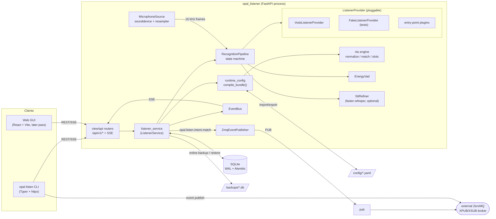
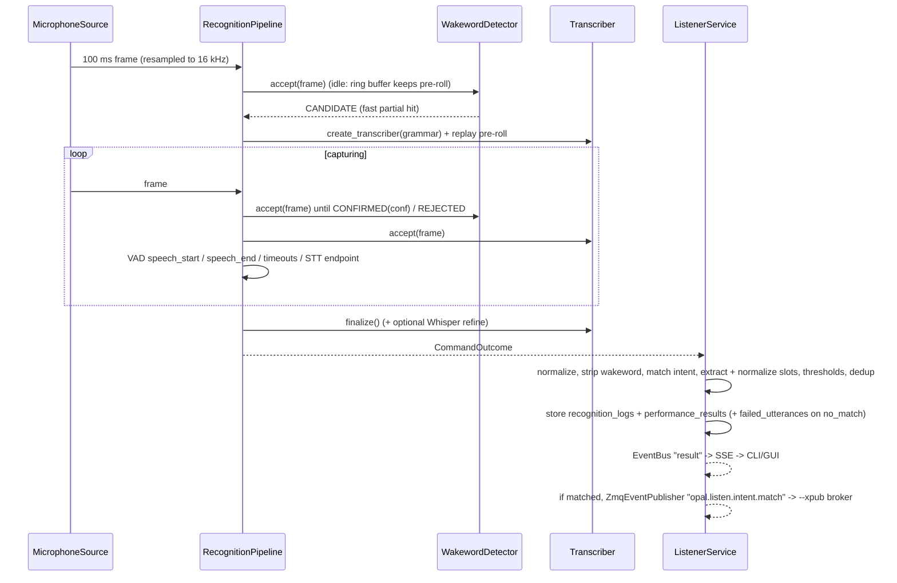

# opal_listener V1 design

Scope: a reliable, testable, tunable wakeword + STT + intent + slot engine. No execution, TTS, agents or
automation in V1. Everything is local (SQLite, Vosk, optional faster-whisper).

## 1. Architecture



Runtime flow (live microphone):



Key decisions (validated on the Pi with `vosk-model-small-en-us-0.15`):

- **Grammar-constrained command STT.** The transcriber is created with phrase fragments derived from the
  enabled intents (literal runs between placeholders, slot values/aliases, number words). This fixed
  misrecognitions that open dictation and flat word lists produced ("kitchen lie it", dropped short words).
- **Two-stage wakeword.** A fast `[wakeword, [unk]]` recognizer opens the session on a partial hit (no
  command audio lost); a second recognizer with sound-alike *distractors* (`commuter, compute, ...`)
  confirms with a real word confidence or rejects. This removed false triggers on "commuter"/"compute".
- **Frame-driven pipeline.** The same `RecognitionPipeline` processes live audio and uploaded WAVs, so
  audio fixture tests exercise the production code path.
- **One validation path.** DB contents are exported to a `ConfigBundle` and compiled by the same
  `compile_bundle()` used for YAML import and `config validate`.

**ZeroMQ event bus.** This is independent of the REST API / SSE `EventBus` above; both the server and
the CLI talk to an external ZeroMQ XPUB/XSUB broker (`opal_listener` does not bind or run that broker
itself — point `--xpub`/`OPAL_EVENT_XPUB_URL` at one).

- **Server → bus.** `ListenerService` holds a `ZmqEventPublisher` (`service/zmq_events.py`), connected to
  `app_settings.xpub_url` (default `tcp://127.0.0.1:5555`, env `OPAL_EVENT_XPUB_URL`, no `OPAL_LISTENER_`
  prefix so it matches the CLI/broker's own naming). `ListenerService.startup()` connects it eagerly —
  not lazily on first publish — so the handshake has the whole startup window to settle before the first
  real event, sidestepping the ZeroMQ "slow joiner" problem without an artificial sleep. Every time
  `_record()` processes a `RecognitionResult` with `matched=True` (text, audio file or live mic), it
  publishes the full result (JSON) under topic `opal.listen.intent.match`. Publish failures are logged
  and swallowed: event delivery is best-effort and must never break recognition.
- **CLI → bus.** `opal listen event publish TOPIC MESSAGE`
  ([CLI.md §18](CLI.md#18-event--publish-zeromq-events)) opens its own short-lived `PUB` socket, connects
  to `--xpub`, and sends a `[TOPIC, MESSAGE]` frame pair; unlike the server it sleeps briefly after
  connecting (0.2 s) since there's no equivalent "connect early" opportunity for a one-shot command.

`--xsub`/`OPAL_EVENT_XSUB_URL` (default `tcp://127.0.0.1:5556`) names the broker's other endpoint; neither
the server nor `event publish` uses it today — it's accepted for symmetry with future subscriber-side
tooling.

## 2. Service responsibilities

| Component | Responsibility |
|---|---|
| `service/listener_service.py` `ListenerService` | Owns the runtime snapshot, provider instances, live runtime thread (capture → pipeline → results), watchdog/recovery with exponential backoff, cooldown/dedup, recognition logging, performance tracking, `config_change()` transactional guard, import/backup/restore with rollback, event publishing. |
| `service/providers/base.py` `ListenerProvider` | Pluggable speech engine: `load/check/is_loaded`, `create_wakeword_detector(wakewords)`, `create_transcriber(grammar)`. Emits `CANDIDATE / CONFIRMED / REJECTED` wakeword events. `SttRefiner` for second-pass STT. |
| `service/providers/vosk_provider.py` | Vosk model cache, two-stage wakeword detector, grammar transcriber, OOV filtering (`vosk_model_find_word`). |
| `service/providers/registry.py` | Built-ins (`vosk`, `fake`) + third-party providers via the `opal_listener.providers` entry point. |
| `service/pipeline.py` | State machine: idle (wakeword + pre-roll ring) → capturing (transcriber + VAD + wake confirmation) → outcome. Measures wakeword/STT latency and audio level. |
| `service/audio/*` | Microphone capture (device resolution, supported-rate probing, streaming FIR decimator 48k→16k), WAV decoding/validation, energy VAD with adaptive noise floor. |
| `service/nlu/*` | Normalization + filler removal, wakeword stripping, template expansion, number parsing, intent matching, slot extraction/normalization, grammar generation. |
| `service/runtime_config.py` | Validates a full bundle (schemas, duplicates, references, settings, profiles) and compiles the immutable `RuntimeSnapshot` for the active profile. |
| `service/catalog.py`, `recognition_store.py`, `review.py`, `backup.py`, `health.py` | CRUD, logs/perf queries, regression + promotion, SQLite backups, startup/doctor checks. |
| `view/api/*` | Thin FastAPI routers; one per contract tag. |
| `cli/*` | Typer CLI; every command is an HTTP call (`OPERATION_COMMANDS` maps each REST operation to a command). |

## 3. SQLite schema

Managed by Alembic (`opal_listener/data/migrations`, revision `0001`). `PRAGMA foreign_keys=ON`, WAL.

| Table | Columns (all snake_case) |
|---|---|
| `wakewords` | id, name (unique, normalized), enabled, confidence_threshold, created_at, updated_at |
| `intents` | id, name (unique), description, enabled, confidence_threshold, created_at, updated_at |
| `intent_phrases` | id, intent_id → intents (cascade), phrase, created_at; unique(intent_id, phrase) |
| `slots` | id, name (unique), slot_type (`list`/`number`/`text`), description, created_at, updated_at |
| `slot_values` | id, slot_id → slots (cascade), value, created_at; unique(slot_id, value) |
| `slot_aliases` | id, slot_value_id → slot_values (cascade), alias, created_at; unique(slot_value_id, alias) |
| `profiles` | id, name (unique), description, is_active, wakeword_names, confidence_thresholds, vad_settings, enabled_intents, enabled_slots, model_paths (JSON), created_at, updated_at |
| `settings` | id, key (unique), value (string, typed by the settings registry), updated_at |
| `recognition_logs` | id, session_id, source (`mic`/`audio`/`text`), profile_name, wakeword, transcript, normalized_transcript, intent_name, slot_values (JSON), wakeword_confidence, stt_confidence, intent_confidence, matched, no_match_reason, total/wakeword/stt/intent_latency_ms, audio_level, created_at |
| `failed_utterances` | id, transcript, expected_intent, notes, recognition_log_id → recognition_logs (set null), reviewed, promoted_to_phrase, created_at |
| `regression_tests` | id, name, phrase, expected_intent (`no_match` for negatives), expected_slots (JSON), enabled, last_result, last_run_at, created_at |
| `performance_results` | id, recognition_log_id → recognition_logs (cascade), wakeword/stt/intent/total_latency_ms, wakeword_confidence, intent_confidence, matched, audio_level, created_at |

Retention: `max_recognition_logs` (default 10 000) pruned every 100 results.

## 4. API contract

`opal_listen.yaml` is the source of truth (currently pinned to the OPAL SUITE STANDARD v1.2; prior
versions are kept as `opal_listen.1.0.0.yaml` / `opal_listen.1.2.0.yaml` for reference).
`tests/test_contract.py` asserts that the generated OpenAPI is a compatible superset: same paths,
methods, operationIds, tags, parameters, request bodies, response codes, schemas, field types,
constraints and required lists. Additive changes (all optional/backwards compatible):

| Change | Why |
|---|---|
| Typed responses: `RecognitionResult` (test_text/test_audio/SSE), `PipelineStatus`, `PerformanceSummary`, `HealthReport`, `AudioDevice`, `BackupInfo`, `RegressionRunResult`, `PromoteResult`, `ConfigBundle`, `ConfigValidationReport`, `ConfigImportResult` | contract had free-form objects; GUI/CLI need stable shapes |
| `IntentCreate.phrases` | create an intent with phrases atomically (validated together) |
| `SlotReadWithValues.values[].aliases` | list slots with aliases in one call |
| `RecognitionLogRead.source/profile_name/stt_confidence/no_match_reason`, `PerformanceResultRead.audio_level` | tuning and failure review |
| Query params: `test_text/test_audio?save_log`, `test_audio?require_wakeword`, `stream?debug`, `promote?create_regression` | test tooling |
| Optional body on `POST /backup/import`, new `POST /backup/validate` | CLI is REST-only, so it uploads local YAML as a bundle |

### OPAL SUITE STANDARD v1.2

Every request/response carries the four OPAL correlation headers (`X-Opal-Session-Id`,
`X-Opal-Transaction-Id`, `X-Opal-Request-Id`, `X-Opal-Causation-Id`): opaque 1–128 character printable
ASCII tokens, validated by `OpalContextMiddleware` (`view/opal_middleware.py`). Missing transaction/request
ids are assigned server-side; a malformed supplied header yields `422` in the `OpalError` envelope
(`{"error": {"code", "message", "request_id", "transaction_id", "session_id"?, "causation_id"?}}`).

Mutable portable configuration (wakewords, intents, phrases, slots, slot values, aliases, profiles,
settings) uses strong, content-derived `ETag`s (`service/concurrency.py`) and mandatory `If-Match` on
`PATCH`/`DELETE`: missing or empty → `428`, stale → `412` (both `OpalError`-shaped). Sub-resources without
their own `GET` (phrases, slot values, aliases) are gated on the parent collection's ETag. Settings are
exposed as a single atomic resource — `GET`/`PATCH /api/v1/settings/` exclusively, no per-key routes —
and `PATCH` applies all supplied keys in one transaction (rolled back entirely on any invalid value).

Growing histories (`GET /logs/`, `GET /performance/history`) use opaque cursor pagination (stable
descending `created_at`+`id` ordering, `items`/`next_cursor`/`has_more`); cursors are scoped to their
exact filter set and rejected (`422`) if reused with different filters or after corruption.
`/api/v1/health/live` and `/api/v1/health/ready` add standard liveness/readiness probes
(`OpalHealthProbe`: `status`, `ready`, `details`; `503` when unavailable) alongside the existing
`GET /api/v1/health/` doctor report. Configuration export/import/validation excludes history (logs,
performance, regression results are never part of `ConfigBundle`) — there are currently no secret-valued
settings, so no redaction is needed, but the standard reserves the exclusion for when one is added.

Error model: `422` uses the FastAPI `HTTPValidationError` shape for request-body/path/query validation
and configuration validation (`type: config_invalid`); routes with no such validation surface of their
own (pure collection GETs, health, root, …) document `422` as `OpalError` instead, since the only way
they can fail is an invalid correlation header. `404` not found, `409` duplicate, `503` provider
unavailable, `412`/`428` as described above.


`RecognitionResult` (V1 success example plus diagnostics):

```json
{"session_id": "8d51…", "source": "audio", "profile_name": "default",
 "wakeword": "computer", "transcript": "turn on the kitchen light",
 "normalized_transcript": "turn on the kitchen light", "intent_name": "light_turn_on",
 "slot_values": {"room_name": "kitchen"}, "wakeword_confidence": 1.0, "stt_confidence": 0.93,
 "intent_confidence": 1.0, "matched": true, "no_match_reason": null,
 "matched_phrase": "turn on [the] {room_name} (light | lights)",
 "alternatives": [{"intent_name": "light_turn_off", "confidence": 0.66, "phrase": "…"}],
 "wakeword_latency_ms": 10, "stt_latency_ms": 15, "intent_latency_ms": 1, "total_latency_ms": 37,
 "audio_level": -23.2, "deduplicated": false, "recognition_log_id": 1, "created_at": "…"}
```

Latency definitions: `wakeword_latency_ms` = audio time from end of the wakeword to detection + processing
delay; `stt_latency_ms` = finalize (+refine) time after end of speech; `intent_latency_ms` = normalize + match;
`total_latency_ms` = end-of-speech decision → result ready (text tests: intent latency).

SSE (`GET /api/v1/recognition/stream?debug=`): events `status`, `wakeword_candidate`, `wakeword_confirmed`,
`wakeword_rejected`, `speech_start`, `speech_end`, `result`; debug adds `audio_level` and `partial`.

## 5. React UI structure (implemented in the frontend pass)

```
opal_listener/view/web/            React + TypeScript + Vite + Tailwind + shadcn/ui
  src/api/schema.d.ts              generated from /openapi.json (openapi-typescript) – snake_case preserved
  src/api/client.ts                typed fetch wrapper + SSE hook (useRecognitionStream)
  src/components/ui/               shadcn primitives
  src/components/                  LevelMeter, ResultCard, ConfidenceBadge, PhraseEditor, JsonView
  src/features/<resource>/         wakewords, intents, slots, profiles, settings, failed, regression,
                                   logs, performance, config, system (queries, forms, tables)
  src/pages/                       Dashboard · Test (text / audio upload / live + debug) · Wakewords ·
                                   Intents · Slots · Profiles · Failures · Regression · Logs ·
                                   Performance · Config (validate/backup/restore/import/export) · System
  tests/                           Vitest + Testing Library + MSW (component), Playwright (e2e)
```

Parity rule: each page action calls exactly one REST operation already mapped in `OPERATION_COMMANDS`, so
GUI ⇔ REST ⇔ CLI stay 1:1; a Playwright test walks the same flows as `test_cli.py`.

## 6. CLI design

`opal listen [--api-url URL] [--xpub URL] [--xsub URL] [--json] [--timeout S] <group> <command>`;
`OPAL_LISTEN_API_URL` sets the default API URL, `OPAL_EVENT_XPUB_URL`/`OPAL_EVENT_XSUB_URL` set the
default ZeroMQ event bus endpoints (`tcp://127.0.0.1:5555`/`5556`). Names or ids are accepted wherever a
resource is referenced. Human output uses rich tables; `--json` prints raw API responses. Non-zero exit
codes on API errors, failed regression runs, invalid config, doctor errors and `--expect-intent`
mismatches (CI friendly).

| Group | Commands |
|---|---|
| `wakewords` | list, get, add, update, remove |
| `intents` | list, get, add (`--phrase` repeatable), update, remove, phrases, add-phrase, remove-phrase |
| `slots` | list, get, add, update, remove, values, add-value (`--alias`), remove-value, aliases, add-alias, remove-alias |
| `profiles` | list, get, add, update, remove, activate (`--threshold k=v`, `--vad k=v`, `--intent`, `--slot`, `--wakeword`, `--model k=path`) |
| `settings` | list, set (atomic PATCH with an auto-fetched ETag/If-Match; see §4 OPAL SUITE STANDARD v1.2) |
| `test` | text, audio, listen, listen-debug, regression |
| `pipeline` | start, stop, status |
| `failed` | list, get, add, update, remove, promote |
| `regression` | list, get, add, update, remove |
| `logs` | list, get, count |
| `perf` | last, summary, history |
| `config` | validate (`--from-dir`), backup, backups, restore, download, delete-backup, export (`--out-dir`), import (`--from-dir`) |
| `system` | doctor, devices, live, ready, info, ping |
| `event` | publish (`TOPIC MESSAGE`) — bypasses the REST API, publishes directly onto the ZeroMQ `--xpub` event bus |

## 7. Intent / slot schema

```yaml
# intents.yaml
intents:
  - name: light_turn_on            # snake_case, unique, 'no_match' reserved
    confidence_threshold: 0.75     # floored by the active profile's confidence_thresholds.intent
    phrases:
      - turn on [the] {room_name} (light | lights)   # [optional]  (alt | ernatives)  {slot}
# slots.yaml
slots:
  - name: room_name
    slot_type: list                # list | number | text (text needs stt_mode=open)
    values:
      - value: living_room         # canonical value returned in slot_values
        aliases: [lounge, family room]
  - name: temperature
    slot_type: number              # "twenty one" / "21" -> 21
```

Matching: templates expand to variants (≤128 each); per variant the transcript is delexicalized (exact
then fuzzy slot surfaces, numbers), aligned with a weighted LCS (stopwords 0.4, words 1.0, slots 1.5,
fuzzy token equality ≥ `token_fuzzy_min_score`) and scored with a weighted Jaccard. `intent_confidence` =
alignment × mean slot score. Reasons for `no_match`: `empty_transcript`, `no_candidate`, `missing_slot`,
`below_threshold`, `low_stt_confidence`, `no_speech`, `no_wakeword`.

Compile-time validation: unknown/duplicate slots in a phrase, template syntax, empty list slots,
aliases mapping to two values, invalid names, ambiguous phrases (warning), intents without phrases (warning).

Profiles (`profiles.yaml`): `wakeword_names`, `enabled_intents`, `enabled_slots` (empty = all),
`confidence_thresholds` {`wakeword`, `intent`, `stt`} as floors, `vad_settings` (`energy_threshold_dbfs`,
`noise_margin_db`, `speech_start_ms`, `silence_end_ms`, `no_speech_timeout_ms`, `max_utterance_ms`,
`pre_roll_ms`, `use_stt_endpoint`), `model_paths` {`vosk_model`, `whisper_model`}. Exactly one active.

Settings are split into `stt.yaml` (provider, model, grammar mode, refiner, wakeword trigger/distractors,
audio device/rate/block) and `settings.yaml` (cooldown, dedup, failure capture, fillers, fuzzy scores,
watchdog, retention). Unknown keys and wrong types are rejected.

## 8. Testing strategy

| Requirement | Where | Notes |
|---|---|---|
| Golden set | `tests/regression/golden_phrases.yaml`, `tests/audio/manifest.yaml` (`set: golden`) | text + WAV must match intent and slots |
| Negative set | `tests/negative/negative_phrases.yaml`, audio `set: negative` | must be `no_match` with a reason |
| Noise set | `tests/noise/test_noise.py` | golden WAVs + seeded white/pink noise at 20/10 dB SNR, pass-rate baselines; pure noise never wakes |
| Wakeword FP/FN | `tests/audio/test_audio_fixtures.py` | sound-alikes ("commuter", "compute") and commands without wakeword must not wake; every wakeword fixture must |
| Audio fixtures | `tests/audio/fixtures/*.wav` | espeak/sox generated from the manifest, full pipeline via REST |
| Regression | `tests/regression/test_regression_suite.py` | golden set via `/regression/run`, promotion loop, breaking-change detection |
| Schema validation | `tests/test_config_schema.py` | every shipped YAML/profile, error messages per file |
| API | `tests/test_api.py`, `tests/test_backup_and_config.py`, `tests/test_contract.py` | CRUD, validation-before-apply, errors, contract superset |
| CLI | `tests/test_cli.py`, `tests/test_e2e_server.py` | every command; parity map; real uvicorn + SSE |
| Migrations | `tests/test_migrations.py` | upgrade/downgrade, model drift, FK enforcement |
| Runtime | `tests/test_pipeline_runtime.py` | state machine, cooldown, dedup, watchdog restart, device recovery |
| Frontend | `view/web/tests` (frontend pass) | Vitest component tests + Playwright flows |

Vosk-dependent tests are marked `vosk` and skipped when the model is missing; noise tests are `slow`.

## 9. Reliability strategy

- **Validate before apply:** every mutation runs in `config_change()`: flush → export → compile → provider
  checks (model path) → commit → atomic snapshot swap. Any failure rolls back the transaction; the running
  snapshot is untouched.
- **Rollback:** config import takes a `pre_import` backup and replaces config in one transaction; restore
  verifies integrity + tables, takes a `pre_restore` backup, copies, migrates, recompiles and restores the
  safety backup automatically if anything fails.
- **Backups:** SQLite online backup API; filenames validated against a strict pattern and resolved inside
  the backup dir (path traversal protection).
- **Startup health checks** (`/api/v1/health/`, `opal listen system doctor`): SQLite, migration head,
  slots/intents compile, provider/model path, model load, vocabulary coverage, microphone, listener, disk.
  An invalid seed or stored config is reported but never crashes the API.
- **Watchdog/recovery:** the runtime thread restarts capture when no frames arrive within
  `audio_watchdog_timeout_ms` or the stream/device fails, with 1→30 s exponential backoff; state and
  `audio_restarts`/`last_error` are exposed via status and SSE.
- **Graceful no_match:** every path returns a `RecognitionResult` with a `no_match_reason`; no_match
  utterances from audio sources are captured as failed utterances for review/promotion.
- **Bounded resources:** bounded audio and SSE queues (drop oldest), upload size limit, log retention.

## 10. Docker Compose layout

```
Dockerfile                         python:3.12-slim-bookworm, libportaudio2, non-root user in 'audio'
opal_listener/docker-compose.yml
  services.listener                build context '..'; port 8000; healthcheck /healthz
    volumes: listener_data:/data (SQLite + backups)
             ./config:/config:ro (YAML seed/import)
             ${VOSK_MODELS_DIR}:/models:ro
    devices: /dev/snd; group_add: ${AUDIO_GID:-29}
    build arg EXTRAS=whisper enables faster-whisper
  services.web                     (frontend pass) nginx serving view/web build, proxy /api -> listener
```
